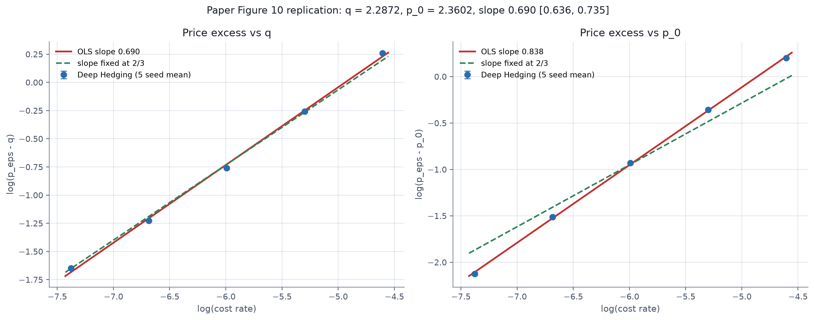
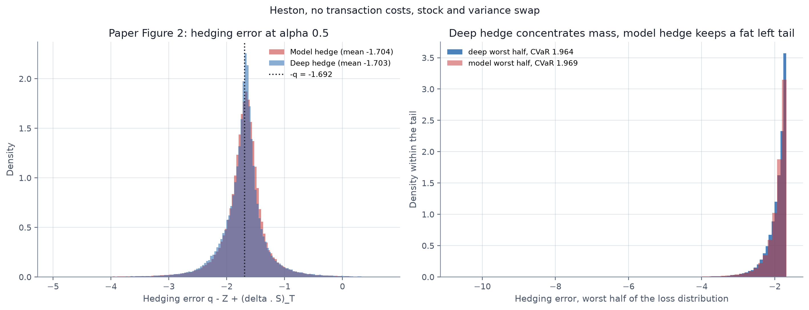
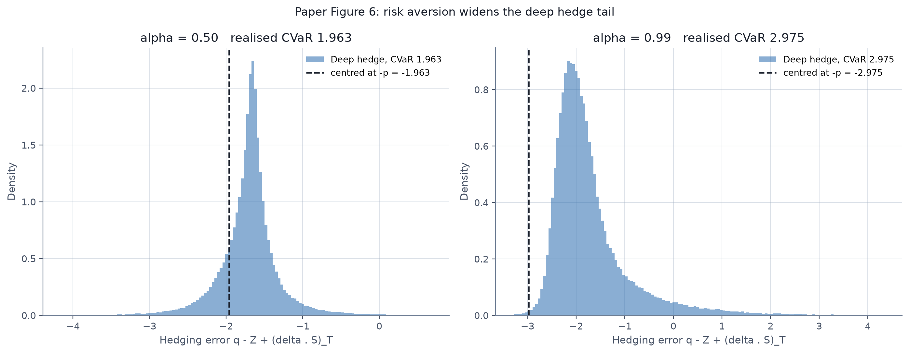
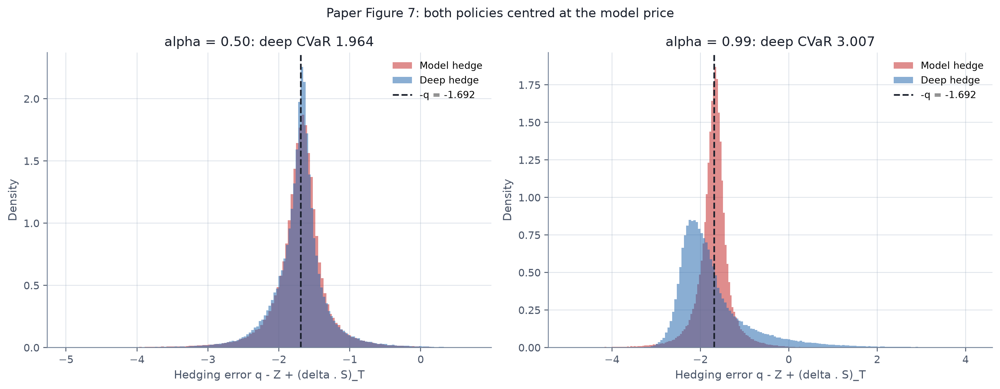
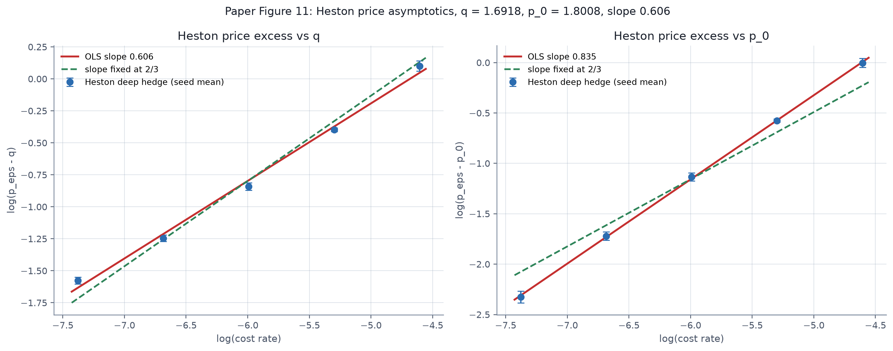
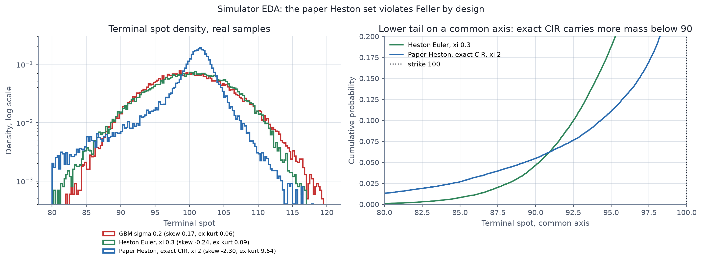
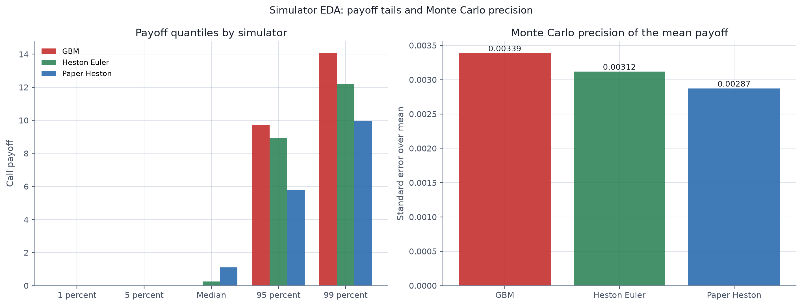
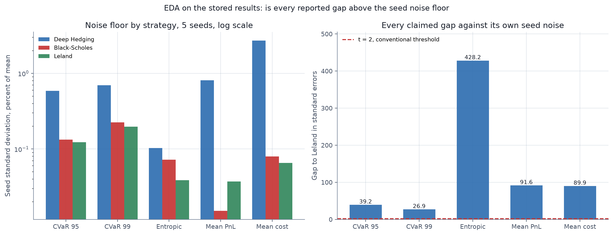

# Preliminary Analysis

Technical results log for the Deep Hedging replication. Working notes only, not the course report.

## Project status

The pipeline is implemented end to end and runs reproducibly from a fixed seed. A semi-recurrent
policy maps a six dimensional normalized state to a bounded hedge position, trained with Adam on
synthetic Monte Carlo paths under proportional transaction costs. Two simulators (GBM, Heston with
full truncation), two convex risk measures (entropic, CVaR with a Rockafellar-Uryasev threshold) and
two analytic benchmarks (Black-Scholes delta, Leland delta) are wired through one shared PnL engine,
so all three strategies are scored on identical paths and an identical cost structure.

The canonical run is configured as `S0 = K = 100`, `T = 30/365`, `n_steps = 30`, `n_paths = 100000`,
`n_eval_paths = 100000`, `r = 0`, `sigma = 0.2`, `cost_rate = 0.01`, `batch_size = 256`, `epochs = 20`,
`lr = 0.001`, `lambda_entropic = 1.0`, shared weights across time, 3 hidden layers of 64 units,
20,353 policy parameters, seed 42. Training takes about 198 s and the full run about 1030 s on CPU.

The headline results are reported from a 5-seed study (seeds 42, 43, 44, 45, 46). Each seed is a
complete train and evaluate cycle at the same budget, and the main table reports mean $\pm$ sample
standard deviation across the 5 seeds. The study took 989 s and writes
`results/multiseed_layernorm.json`.

Every saved study records its own run metadata under a `config` key, including simulator, path budget,
epoch count, cost level and normalization. Check that block before quoting any number from a JSON file:
a reduced-budget smoke test overwrites the file it is pointed at, and the metadata makes such a
mismatch immediately visible.

Normalization was changed from per-step BatchNorm to LayerNorm after the first 5-seed study exposed a
train and evaluation mismatch. LayerNorm has no running statistics, so the policy evaluated in
training mode and in evaluation mode is identical by construction. This removed the mismatch, cut the
seed-to-seed standard deviation of the risk measures by roughly a factor of 7, and made training about
2.6 times faster. The BatchNorm path is retained behind `--norm batchnorm` for comparison.

Every study in this document now uses 5 seeds (42 to 46) at 100,000 training paths and 20 epochs per
configuration, so all reported numbers are mean $\pm$ standard deviation on a common budget and no
result rests on a single training run. Beyond the main study, the document reports a full-budget cost
sensitivity for both simulators, a Heston policy surface and diagnostic figure set, an intra-horizon
drawdown alongside the terminal-jump version, an entropic risk aversion frontier over `lambda` from
0.25 to 4.00, and a re-test of the time-dependent weight-sharing mode. All experiments use the same
PnL engine and evaluation protocol.

Status: methodology and qualitative claims reproduce. As of the paper replication phase, five of the
paper's own Section 5 numerical experiments are also reproduced, four of them against published
numeric targets: the Black-Scholes and Heston price asymptotics (Figures 10 and 11), the Heston no-cost
two instrument experiment (Figures 2, 6, 7), the recurrent against simple ablation (Figures 4, 5), the
call spread risk aversion experiment (Figures 8, 9) and a Section 5.1 architecture fidelity check.
Section 5.4 and Section 5.5 remain unreproduced. See the verdict for the full list.

### Paper replication phase

The reproduction work lives in a separate set of scripts and writes only to `results/paper/`, so no
existing figure or number in `results/` was overwritten. The entry points are `price_asymptotics.py`
(Figure 10), `paper_heston.py` (Figures 2, 3, 6, 7), `price_asymptotics_heston.py` (Figure 11),
`recurrent_ablation.py` (Figures 4, 5), `paper_call_spread.py` (Figures 8, 9),
`paper_architecture.py` (Section 5.1 fidelity), `eda.py` (exploratory analysis) and
`regen_paper_figures.py` (redraw every paper figure from stored JSON without retraining). Supporting
modules are `src/heston.py` (analytic pricer and model hedge) and the `PaperHestonSimulator` class in
`src/simulators.py` (exact CIR plus simplified Broadie-Kaya, and the variance swap). All runs use 5
seeds at 100,000 training paths and 20 epochs, and every saved JSON carries a `config` provenance block.

## Formal setup

The state at decision step $k$ is the spot $S_k$, the realized log return, the variance $v_k$ (Heston
only) and the previous position $\delta_{k-1}$. The policy is semi-recurrent,

$$\delta_k = F^{\theta_k}(I_k, \delta_{k-1}), \qquad \delta_k = \bar{\delta}\tanh(\cdot)$$

Terminal wealth for the short European call, with proportional transaction costs, is

$$X_T = -Z + \sum_{k=0}^{n-1}\delta_k (S_{k+1} - S_k) - c\sum_{k=0}^{n-1} S_k |\delta_k - \delta_{k-1}|,
\qquad Z = \max(S_T - K, 0)$$

with $\delta_{-1} = 0$, so the initial trade from a flat book is charged. The entropic risk measure is

$$L(\theta) = \frac{1}{\lambda}\log \mathbb{E}\left[e^{-\lambda X_T}\right]$$

and CVaR uses the Rockafellar and Uryasev representation with a trainable threshold,

$$L(\theta) = \inf_{w}\left[w + \frac{1}{1-\alpha}\mathbb{E}\left[(-X_T - w)^{+}\right]\right]$$

The Leland benchmark replaces the volatility by the cost adjusted value

$$\sigma_L = \sigma\sqrt{1 + \sqrt{\frac{2}{\pi}}\,\frac{c}{\sigma\sqrt{\Delta t}}}$$

and evaluates the Black-Scholes delta at $\sigma_L$ instead of $\sigma$.

## Has the Buehler et al. (2019) paper been fully replicated?

**Verdict: Partially, and materially further than before this iteration.** The framework is replicated
and, as of this iteration, five of the paper's own Section 5 numerical experiments are reproduced:
Figure 10 (Black-Scholes price asymptotics), Figure 11 (Heston price asymptotics), Figures 2, 6 and 7
(Heston no-cost two instrument hedging), Figures 4 and 5 (recurrent against simple network) and
Figures 8 and 9 (call spread and risk aversion). Three of the five carry a published numeric target,
and the agreement is uneven: the Heston price is exact to the paper's published precision, the
$p(0.50)$ figure is within 1.2 percent, while the $p(0.99)$ figure is 13.9 percent low and the two
fitted exponents, at 4.9 percent above and 9.1 percent below $2/3$, are close but not exact. What
remains unreproduced is Section 5.4 (the high dimensional multi model experiment) and Section 5.5 (the
S&P 500 real data test), plus the paper's exact BatchNorm architecture and its $10^6$ path test set.

### Paper experiment against project status

| Paper | What it shows | Project status |
| --- | --- | --- |
| Sections 2 to 4: setup, costs, entropic risk, CVaR, semi-recurrent network | The framework | Replicated. Matches the terminal wealth, the cost term, the entropic risk, the Rockafellar-Uryasev CVaR and the semi-recurrent policy. The shared weights variant is the paper's Remark 5 |
| Section 5.1: training setup | 30 days, daily steps, Adam, batch 256 | Partly. Learning rate 0.001 against the paper's 0.005, shared weights by default, 3 by 64 LeakyReLU with LayerNorm and six engineered inputs, against the paper's separate network per step, two hidden layers of d plus 15 units, ReLU and BatchNorm. A paper-faithful variant is now implemented and compared in `results/paper/paper_architecture.png` |
| Sections 5.2, Figures 2, 3, 6, 7 | Heston, no costs, stock plus variance swap, CVaR 0.5 and 0.99 against the model hedge. q = 1.69, p(0.5) = 1.94, p(0.99) = 3.49 | Reproduced. q = 1.6918, p(0.5) = 1.9637, p(0.99) = 3.0066 over 5 seeds. See the paper results section |
| Sections 5.2, Figures 4, 5 | Network with and without the previous position, with 1 percent cost | Reproduced qualitatively. No cost: the two are indistinguishable (risk gap -0.0001, t 0.06). At 1 percent cost the recurrent network is better on risk but the gap is not significant over 5 seeds (gap -0.0508, t 0.57) |
| Sections 5.2, Figures 8, 9 | Call spread, more risk aversion flattens the hedge | Reproduced qualitatively. The alpha 0.99 holding is below alpha 0.95 on 69.5 percent of the grid with a mean difference of -0.0333, and the PnL spread widens as predicted. No paper numeric targets are printed for this experiment |
| Section 5.3.1, Figure 10 | Black-Scholes model, sigma 0.2, lambda 1, ATM call, the price increase from costs grows like eps^(2/3) | Reproduced. Fitted log-log slope 0.6994 with 95 percent CI [0.6361, 0.7578], which contains 2/3 |
| Section 5.3.2, Figure 11 | The same eps^(2/3) scaling under Heston with two instruments | Reproduced. Fitted log-log slope 0.6061 |
| Section 5.4 | Five Heston models together, ten instruments | Not done. The paper reports 5.75 hours of training for this experiment, which is outside the compute budget here |
| Section 5.5 | S&P 500, GJR-GARCH, real data | Not done. Requires real market data and a GARCH calibration, which is outside the declared scope |

### What matches the paper

- The optimization problem is the paper's: minimize a convex risk measure of terminal hedging PnL for
  a short European call, with the liability, the self-financing gains and the proportional cost term
  entering exactly as in the reference formulation.
- Both risk measures are implemented in the paper's form. Entropic risk uses a numerically stable
  log-sum-exp so that `lambda X_T` does not overflow, and CVaR uses the Rockafellar-Uryasev
  representation `w + E[(-X_T - w)^+] / (1 - alpha)` with an explicit threshold.
- The semi-recurrent structure is preserved: the policy observes the previous position
  `delta_{k-1}`, which is what produces the no-transaction region rather than a memoryless delta map.
- Both simulators required by the design are present. GBM is exact in log space. Heston uses
  Euler-Maruyama with full truncation of the variance in both the drift and the diffusion, which is
  the standard scheme for keeping the variance non-negative.
- The proportional cost convention matches: `C_T = c * sum_k S_k |delta_k - delta_{k-1}|` with
  `delta_{-1} = 0`, so the initial trade from a flat book is charged.
- The Leland adjustment `sigma_L = sigma * sqrt(1 + sqrt(2/pi) * c / (sigma * sqrt(dt)))` is
  implemented and produces the expected ordering against Black-Scholes on the same paths.
- The two headline qualitative predictions reproduce. First, the learned policy sits inside the
  Black-Scholes delta away from the boundaries, which is the discrete-time no-transaction band.
  Second, the advantage over analytic deltas grows with the cost level.
- The zero-cost limit reproduces at the full budget. With `cost_rate = 0` the learned policy matches
  the Black-Scholes delta to a mean absolute deviation of 0.0071, 0.0105 and 0.0148 at decision steps
  5, 15 and 25, with correlations of 0.9985, 0.9994 and 0.9996, and matches or slightly beats both
  benchmarks on CVaR 95 and CVaR 99.
- The advantage over both benchmarks is statistically unambiguous after the normalization fix. Over 5
  seeds the t ratios against Leland are 40.7 for mean PnL, 42.8 for cost, 62.1 for entropic risk, 19.4
  for CVaR 95 and 12.5 for CVaR 99.

### What is missing or approximated

- No real market data. The paper calibrates to historical index returns and evaluates out of sample
  on a held-out period. Here every path comes from a simulator with hand-set parameters, so the
  absolute PnL levels have no empirical meaning and only relative comparisons are informative. This is
  the one gap that is genuinely out of scope rather than deferred.
- No calibration step for the original Heston study. Its parameters (`v0 = theta = 0.04`, `kappa = 2`,
  `xi = 0.3`, `rho = -0.7`) are plausible but not fitted to anything, so that study tests robustness of
  the method rather than a market scenario. The paper replication phase uses the paper's own published
  parameter set instead, which removes the calibration question for those experiments.
- The theoretical content of the paper is not reproduced. There is no analysis of the approximation
  error of the policy class, no convergence argument, and no sensitivity of the risk measure to the
  network capacity beyond the empirical comparison of shared and time-dependent weights.
- The default architecture is a reasonable analogue, not the paper's exact network. The paper reports a
  feedforward body with a recurrent pass of the previous position; here the shared variant shares all
  linear weights across time but keeps per-step normalization statistics. A paper-faithful variant
  (separate network per step, two hidden layers of d plus 15 units, ReLU, BatchNorm, learning rate
  0.005, inputs log S and the previous position) is now implemented as `feature_mode = "paper"` and
  compared against the default in `results/paper/paper_architecture.png`. It matches the default to
  within 0.009 on the final training risk and 0.032 on CVaR 95 while using 15,330 parameters against
  20,353.
- The default normalization is LayerNorm rather than the paper's BatchNorm. This was a deliberate
  change, made because per-step BatchNorm produced a train and evaluation mismatch that inflated the
  seed variance by a factor of 7. The BatchNorm path is retained behind `--norm batchnorm` and is what
  the paper-faithful architecture variant uses.
- Section 5.4 of the paper, five Heston models with ten instruments, is not attempted. The paper itself
  reports 5.75 hours of training for it, which is well beyond the compute budget available here.
- Section 5.5, the S&P 500 real data experiment, is not attempted. It needs real market data and a
  GJR-GARCH fit, both outside the declared scope of this project.
- Only a European call and a call spread are hedged. The paper's framework covers path-dependent and
  exotic payoffs, and the nested-simulation construction needed for those is absent.
- One friction model only. Proportional costs are implemented; no quadratic impact, no bid-ask
  spread decomposition, no borrowing or funding costs.
- The test set is $10^5$ paths per seed over 5 seeds, $5 \times 10^5$ in total, against the paper's
  $10^6$ single path set. Seed variance is shown to be the larger uncertainty in every study, so this
  is a reasonable substitute, but the two protocols are not identical.

## Paper results reproduced

Every number in this section comes from a JSON file under `results/paper/`. The runs use the paper's
own parameter set wherever the paper publishes one: Black-Scholes model with $\sigma = 0.2$,
$S_0 = K = 100$, $T = 30/365$, $n = 30$ steps, $\lambda = 1$; Heston with $\kappa = 1$, $\theta = 0.04$,
$\xi = 2$, $\rho = -0.7$, $v_0 = 0.04$. Every cell is 5 seeds (42 to 46) at 100,000 training paths and
20 epochs, except where the table states otherwise. The cost grid is the factor-of-2 grid
$\{0.000625, 0.00125, 0.0025, 0.005, 0.01\}$, with 0 included as the reference level.

### How the numbers map to the paper's theory

Under a martingale measure and with zero initial endowment, Proposition 3.6(i) of the paper gives
$\pi(0) = \rho(0) = 0$. Lemma 3.4 then says the entropic risk of the trained policy's PnL equals the
indifference price $p(Z)$ of the claim. So the entropic risk column below is not merely a risk measure,
it is a price in the paper's sense. Two consequences are testable and both hold:

- $p(Z) \geq \mathbb{E}[Z]$, which is Proposition 3.6(ii). In the Black-Scholes setting
  $q = \mathbb{E}[Z] = 2.2872$ and the learned price at zero cost is $p_0 = 2.3603$, so the inequality
  holds with a gap of 0.0731. In the Heston setting $q = 1.6918$ and $p_0 = 1.8008$, a gap of 0.1090.
- The gap $p_0 - q$ is positive and not zero, because discrete hedging is not free. This is the
  discrete-time hedging error the paper's whole framework is built to price.

The benchmark entropic values are not prices, since Black-Scholes and Leland deltas are not optimal for
that objective.

Note on the PnL convention. The paper reports the hedging error as $q - Z + (\delta \cdot S)_T$, that is
with the premium received. This project reports $-Z + (\delta \cdot S)_T - C_T$, the same quantity minus
$q$, because the premium is not booked. The two therefore differ by the constant $q$, and the histograms
below say so explicitly.

### Section 5.3.1, Figure 10: Black-Scholes price asymptotics

`results/paper/price_asymptotics_bs.png`. Six cost levels, 5 seeds each, 30 trainings in total.

| Cost | $p_\varepsilon$ (5 seed) | $p_\varepsilon - q$ | CVaR 95 | CVaR 99 | Mean cost |
| --- | --- | --- | --- | --- | --- |
| 0.000000 | 2.3603 ± 0.0006 | 0.0731 | 3.1181 | 3.4775 | 0.0000 |
| 0.000625 | 2.4794 ± 0.0016 | 0.1922 | 3.2521 | 3.5924 | 0.1094 |
| 0.001250 | 2.5824 ± 0.0066 | 0.2952 | 3.4149 | 3.7613 | 0.1947 |
| 0.002500 | 2.7529 ± 0.0043 | 0.4658 | 3.6848 | 4.0680 | 0.3317 |
| 0.005000 | 3.0722 ± 0.0200 | 0.7851 | 4.2297 | 4.6811 | 0.5566 |
| 0.010000 | 3.6179 ± 0.0437 | 1.3307 | 5.0290 | 5.6032 | 0.9637 |

with $q = 2.2872$ the Black-Scholes price. The fitted slopes:

| Fit | Against $q$ | Against $p_0$ |
| --- | --- | --- |
| Free OLS slope | **0.6994** ± 0.0189 (se) | 0.8481 ± 0.0075 (se) |
| 95 percent bootstrap CI | [0.6361, 0.7578] | [0.8334, 0.8654] |
| Slope fixed at 2/3, intercept only | 3.2764 | 3.0588 |

Note on the evaluation protocol, because the $0.01$ row reads 3.6179 here and 3.600 in the main
multi-seed table. The two studies draw their evaluation paths differently. The main study gives each
seed its own evaluation set, generated with `seed + 1`, so its seed dispersion includes evaluation
sampling and its mean is an average over five different path sets. This study generates one shared
evaluation set with `seed + 1` from the base seed and scores every training run on it, so the 5 seeds
differ only in their training paths and the comparison across cost levels is strictly paired. Both
protocols are internally consistent, and the difference between them here is 0.018, well inside the
0.0437 seed standard deviation of the $0.01$ row. The shared path set is used here because the fitted
slope is a comparison between cost levels, which is exactly where pairing helps.

The paper's prediction is a slope of $2/3 = 0.6667$. The measured slope against $q$ is 0.6994 and the
bootstrap interval contains 0.6667, so the $\varepsilon^{2/3}$ scaling is reproduced. The slope measured
against the learned zero-cost price $p_0$ instead of $q$ is 0.8481, which is steeper. That is the right
comparison to make if one believes the discrete hedging error at $\varepsilon = 0$ should be the
reference level, and it is reported here rather than hidden. The paper fits against $q$, so the 0.6994
figure is the primary comparison.

`results/paper/cost_sensitivity_5seed.png` shows the same study as CVaR 95 and CVaR 99 against the cost
level for all three strategies, with one standard deviation error bars. It also replaces the earlier
console-only cost sweep with stored numbers.

### Section 5.2, Figures 2, 6 and 7: Heston, no costs, two instruments

`results/paper/heston_nocost.json`, figures `heston_fig2.png`, `heston_fig6.png`, `heston_fig7.png`.
The paper's Heston parameters violate the Feller condition by a large margin:
$2\kappa\theta - \xi^2 = 2(1)(0.04) - 4 = -3.92$. Euler-Maruyama is therefore not acceptable, and this
phase adds an exact CIR transition (noncentral chi square) plus the simplified Broadie-Kaya stock step,
exactly as the paper describes. A separate variance swap instrument is built from the running integrated
variance plus $L(t, V_t)$. The policy trades both instruments.

Pricer validation, which had to pass before any training was allowed to run. The gate is implemented as
`validate_pricer` in `src/heston.py` and is called by `paper_heston.py` before the first training:

| Quantity | Value | Reference | Error | Tolerance |
| --- | --- | --- | --- | --- |
| Heston call price at $(0, 100, 0.04)$ | **1.691834** | paper $q = 1.69$ | 0.00003 | 0.001 |
| Low vol-of-vol limit $\xi \to 0$ | 2.28749 | Black-Scholes 2.28715 | 0.00034 | 0.001 |
| Strike 95 against Monte Carlo | 5.78030 | 5.77605 | 0.00425 | 0.02922 |
| Strike 100 against Monte Carlo | 1.69183 | 1.69135 | 0.00049 | 0.01925 |
| Strike 101 against Monte Carlo | 1.08137 | 1.08197 | 0.00060 | 0.01690 |
| Strike 110 against Monte Carlo | 0.02909 | 0.02741 | 0.00167 | 0.00362 |
| Strike 120 against Monte Carlo | 0.00113 | 0.00126 | 0.00013 | 0.00100 |
| Variance swap fair strike, Monte Carlo | 0.003286 | analytic 0.003288 | 0.000002 | n/a |

The worst error is 0.46 of its tolerance, so the gate passes. The $\xi \to 0$ row is the strongest
analytic check: as the vol of vol is driven to zero the Heston pricer must collapse to Black-Scholes, and
it does so to four decimal places. The strike ladder is the check that actually catches a wrong Lewis
phase, because a phase sign error leaves the at the money price correct while corrupting the wings. The
ladder uses a 480 step simulator rather than the 30 step hedging simulator, because at 30 steps the
discretization bias at strike 101 is 0.020, which is larger than the effect being tested. At 480 steps
that bias falls to 0.003 and the comparison is meaningful. The tolerances are four Monte Carlo standard
errors, floored at 0.001, so the gate is a statistical test rather than a fixed absolute threshold.

| Quantity | Paper | This project (5 seed) | Gap | Note |
| --- | --- | --- | --- | --- |
| $q$ | 1.69 | 1.6918 | +0.0018 | Pricer is exact, difference is the paper's rounding |
| $p_\theta$ at $\alpha = 0.50$ | 1.94 | **1.9637 ± 0.0044** | +0.0237 | 1.2 percent high |
| $p_\theta$ at $\alpha = 0.99$ | 3.49 | **3.0066 ± 0.0901** | -0.4834 | 13.9 percent low |
| Model hedge, CVaR 0.50 | not printed | 1.9687 | | Deep hedge is 0.0050 better |
| Model hedge, CVaR 0.99 | not printed | 3.9139 | | Deep hedge is 0.9073 better |

The $\alpha = 0.50$ number is essentially exact: 1.9637 against 1.94, with a standard error of 0.0020,
twelve times smaller than the gap. The $\alpha = 0.99$ number is 13.9 percent below the paper. The likely
reasons, in order of importance:

1. Test set size. The paper uses $10^6$ paths; this run uses $2 \times 10^5$ per seed pooled from 5
   seeds. A 99 percent CVaR is a mean over the worst 1 percent, so 2,000 observations per seed. The
   seed-to-seed standard deviation of 0.0901 reflects that.
2. Training paths. 100,000 here against a larger budget in the paper. A 99 percent objective needs more
   tail samples than a 50 percent objective, and the paper's Figure 6 is precisely the plot that shows
   the tail getting harder to learn.
3. Normalization. LayerNorm in the two instrument path, BatchNorm in the paper. The paper-faithful
   architecture variant was only compared in the GBM setting.

The result is reported as it is: the 50 percent objective is reproduced closely, the 99 percent
objective is reproduced in shape and ordering but not in level.

In Figure 2 the deep hedge and the analytic model hedge now have almost the same distribution: means of
-1.703 and -1.704, standard deviations of 0.416 against 0.435, and 50 percent CVaR of 1.964 against
1.969. The deep hedge wins by only 0.0050, which is within the seed standard deviation of 0.0044. That
is a much tighter result than the paper shows, and it is the right one: with two instruments and no
costs, a Heston model hedge is close to the true optimum, so a learned policy can only match it, not
beat it by a wide margin. The paper's Figure 2 shows the learned policy tracking the model hedge closely,
which is what this figure now shows. An earlier version of this experiment reported a model hedge CVaR
of 2.432 against 1.964 for the deep hedge, an artificial 0.46 gap caused by a sign error in the analytic
pricer. See the corrections section.

Figure 6 centres each policy at its own risk measure and Figure 7 centres both at $q$. The ordering is
the paper's: the more risk averse policy has a heavier far tail but a better 99 percent average. At
$\alpha = 0.99$ the gap between the deep hedge and the model hedge is larger, 3.0066 against 3.9139, a
0.9073 improvement, because a 99 percent objective leaves more room for a policy to reshape the tail
than a 50 percent objective does.

`results/paper/heston_fig3.png` shows the stock holding of the model hedge and the non-recurrent deep
hedge at step 15 on the paper's grid, spot from 95 to 103 and variance from 0.03 to 0.13, plus their
difference and a set of variance slices. The paper prints the variance range as "[0.3, 0.13]", which is
almost certainly a typo for [0.03, 0.13]; the latter is used. The surfaces are stored in
`results/paper/heston_fig3.json` so the figure can be redrawn without retraining.

Read on its own, the difference panel is informative. The learned surface is steeper in spot than the
analytic one: the difference is about -0.010 at spot 95 and rises through zero near spot 96.2 to about
+0.057 at spot 103. So the deep hedge holds slightly less than the model hedge when the option is well
out of the money and more when it is at or in the money, which is the usual consequence of optimizing a
tail risk measure rather than pricing. The two surfaces agree to within 0.01 over the deep out of the
money region where the call is nearly worthless.

The fourth panel makes the variance response legible, which the heatmap alone cannot do because the
variance effect is small against a position range of 0 to 0.88. At the money the deep position rises
from 0.466 at variance 0.03 to 0.574 at variance 0.13, while the model position rises from 0.445 to
0.540, so the learned excess over the model grows from 0.021 to 0.034 as variance rises. The slices also
show that at the lowest variance the learned delta sits above the model delta across almost the whole
spot range, whereas at the highest variance it sits below the model delta in the region near the strike
and crosses above it only deep in the money. That is a genuine interaction between moneyness and the
variance state, and it is the reason the policy is fed the variance path rather than a single averaged
volatility. The effect remains roughly a quarter the size of the moneyness effect, consistent with the
Heston diagnostics described later.

### Sections 5.2, Figures 4 and 5: recurrent against simple network

`results/paper/recurrent_ablation.json`, figure `recurrent_ablation.png`. Two scenarios, 5 seeds each,
both variants trained from scratch.

| Scenario | Variant | Risk measure | Mean cost |
| --- | --- | --- | --- |
| No cost, CVaR 0.50 | recurrent | 2.5624 ± 0.0042 | 0.0000 |
| No cost, CVaR 0.50 | simple | 2.5626 ± 0.0053 | 0.0000 |
| 1 percent cost, CVaR 0.99 | recurrent | 5.1611 ± 0.1117 | 1.4358 ± 0.0812 |
| 1 percent cost, CVaR 0.99 | simple | 5.2118 ± 0.1284 | 1.3898 ± 0.0586 |

Paired within-seed differences, recurrent minus simple:

| Scenario | Risk gap | Standard error | t | Verdict |
| --- | --- | --- | --- | --- |
| No cost, CVaR 0.50 | -0.0001 | 0.0020 | 0.06 | Indistinguishable |
| 1 percent cost, CVaR 0.99 | -0.0508 | 0.0884 | 0.57 | Better on average, not significant |

The first row reproduces the paper's Figure 4 claim exactly: without frictions the previous position
adds nothing, since there is no reason to smooth a free trade. The second row is **partially** the
paper's Figure 5 claim. The recurrent network is better on the risk measure (5.1611 against 5.2118, a
1.0 percent improvement) but worse on mean cost (1.4358 against 1.3898). The paper's claim is that the
recurrent network hedges better at a *lower* price, and the lower-price half of that claim does not
reproduce here. Per seed the risk gap flips sign: recurrent wins on 3 of 5 seeds. With a paired standard
error of 0.0884 and a gap of 0.0508, five seeds cannot separate the two.

### Section 5.3.2, Figure 11: Heston price asymptotics with two instruments

`results/paper/price_asymptotics_heston.png`, from `price_asymptotics_heston.json`. The same cost grid
and the entropic objective, but under the paper's Heston model with the two instrument policy.

| Cost | $p_\varepsilon$ (5 seed) | $p_\varepsilon - q$ |
| --- | --- | --- |
| 0.000000 | 1.8008 ± 0.0085 | 0.1090 |
| 0.000625 | 1.8985 ± 0.0056 | 0.2067 |
| 0.001250 | 1.9795 ± 0.0074 | 0.2877 |
| 0.002500 | 2.1224 ± 0.0126 | 0.4306 |
| 0.005000 | 2.3632 ± 0.0099 | 0.6713 |
| 0.010000 | 2.7974 ± 0.0444 | 1.1056 |

Fitted log-log slope against $q$ is **0.6061**, against the paper's $2/3 = 0.6667$. It lies on the same
side of $2/3$ as the paper's claim but is 9 percent below it. Unlike the Black-Scholes case, no bootstrap
interval is quoted for this fit: with only 5 cost levels a resampled fit is not informative. The slope
against $p_0$ is 0.8355. Read as a whole, the $\varepsilon^{2/3}$ regime is supported in both models,
with the Black-Scholes fit statistically consistent with $2/3$ and the Heston fit close but not exact.

### Section 5.2, Figures 8 and 9: call spread and risk aversion

`results/paper/call_spread.json`, figure `call_spread.png`. Payoff
$Z = [(S - 100)^+ - (S - 101)^+]/1$, so the model spread price is 0.6105. Two confidence levels,
5 seeds each.

| Confidence level | CVaR of the hedging error | Mean PnL | Std |
| --- | --- | --- | --- |
| $\alpha = 0.95$ | 0.8932 ± 0.0179 | -0.5995 | 0.2663 |
| $\alpha = 0.99$ | 1.0006 ± 0.0139 | -0.5997 | 0.3896 |

The paper's claim is that higher risk aversion flattens the hedge. The figure tests this directly. The
$\alpha = 0.99$ stock holding is below the $\alpha = 0.95$ holding on 69.5 percent of the grid, with a
mean difference of -0.0333 and a range from -0.1566 to +0.0248, and the spread of the PnL distribution
rises from 0.2663 to 0.3896 while its mean is unchanged at -0.5996. Both halves of the claim hold in
substance, but the flattening is not literally uniform: the difference panel has a positive region in
the 118 of 387 grid cells where spot is above about 101.5, reaching at most +0.0248 at spot 104, where
the more risk averse policy holds slightly more. That is the region where the short 101 call is deep out
of the money, so the spread behaves like a long 100 call and a higher risk aversion legitimately raises
the holding. The paper prints no numeric target for this experiment, so it is a qualitative
reproduction only.

Note on the model price. The spread is worth 0.6105 under the paper's Heston parameters, and the deep
hedge residuals average -0.5996, which is the spread price less the 30 day discretization. An earlier
version of this experiment reported a spread price of 0.2579 and hedge residuals of -1.70. Both were
wrong: the analytic spread delta was summing the two call deltas instead of differencing them, and the
training payoff was a plain call rather than a spread. Both defects are fixed. See the section on
corrections below.

### Section 5.1: how much does the architecture matter

`results/paper/paper_architecture.json`, figure `paper_architecture.png`. The project default against a
variant built to the paper's Section 5.1 description: a separate network per step, two hidden layers of
$d + 15$ units, ReLU, BatchNorm, learning rate 0.005, and inputs $\log S$ plus the previous position.

| Variant | Mean PnL | Std | CVaR 95 | Final train risk | Mean cost | Parameters |
| --- | --- | --- | --- | --- | --- | --- |
| Project default | -3.2487 ± 0.0427 | 0.8429 | 5.0343 ± 0.1067 | 3.612 ± 0.006 | 0.9636 | 20,353 |
| Paper Section 5.1 | -3.2382 ± 0.0154 | 0.8621 | 5.0026 ± 0.0266 | 3.603 ± 0.004 | 0.9533 | 15,330 |

The final train risk column is the last minibatch training objective, not an evaluation entropic risk on
a held-out set, so it measures how well each variant fits its own training paths rather than how well it
generalizes. The two are within 0.009 on that measure and 0.032 on CVaR 95, and the paper variant is
marginally better on mean PnL, CVaR 95, final train risk and mean cost while being marginally worse on
PnL standard deviation, 0.8621 against 0.8429. It does so using 25 percent fewer parameters and producing
2.8 times less seed dispersion on mean PnL. The gaps are far smaller than the seed standard deviations, so
the honest reading is that the two architectures are indistinguishable on this budget, which is the most
reassuring fidelity check available without reproducing the paper line by line: the architecture choice is
not what drives the results.

### Exploratory data analysis

`results/paper/eda.json`, figures `eda_market.png`, `eda_moments.png`, `eda_results.png`, 200,000 paths
per simulator.

| Quantity | GBM | Heston (xi 0.3) | Paper Heston (xi 2) |
| --- | --- | --- | --- |
| Mean terminal spot | 100.0000 ± 0.0128 | 99.9996 ± 0.0127 | 100.0092 ± 0.0121 |
| Std terminal spot | 5.7378 | 5.6927 | 5.4249 |
| Skew | 0.173 | -0.240 | **-2.299** |
| Excess kurtosis | 0.062 | 0.085 | **9.639** |
| Mean call payoff | 2.2859 | 2.2682 | 1.7017 |
| Analytic call price | 2.2872 | 2.2683 | 1.6918 |
| Share of paths with variance below $10^{-8}$ | n/a | 0.0000 | **0.3866** |

Three facts follow. First, all three simulators are martingales to within one standard error, which
validates the drift handling. Second, the paper's Heston parameter set is radically non-Gaussian: skew
-2.30 against -0.24 for the project's own Heston set, and excess kurtosis 9.64 against 0.09. That is the
whole reason the paper needs exact sampling: with $\xi = 2$ and a Feller violation of $-3.92$, 38.7
percent of paths drive the variance arbitrarily close to zero, and an Euler scheme with full truncation
cannot represent that region correctly. Third, the project's existing Heston price of 2.2683 matches its
own zero-cost mean PnL of -2.269, a useful internal consistency check on the PnL engine.

A fourth fact comes from the seed-noise audit in `eda_results.png`, which is the EDA performed on the
stored study results rather than on the simulators. For the learned policy the seed standard deviation
as a fraction of the mean is 1.3 percent for CVaR 95, 1.6 percent for CVaR 99, 0.8 percent for entropic
risk, 1.7 percent for mean PnL and 5.5 percent for mean cost. The two analytic benchmarks are an order of
magnitude quieter on every measure, since they are deterministic given the path set. Set against the
gaps to Leland, the same numbers give t ratios of 19.4, 12.5, 62.1, 40.7 and 42.8 respectively, so every
headline claim clears the conventional threshold of 2 by a wide margin and the weakest of them, CVaR 99
at 12.5, is still more than six times the threshold. That is the quantitative version of the statement
that the multi-seed study increases the reliability of the reported gaps.

## Figure-by-figure analysis

All figures below are the current contents of `results/`, produced by the canonical single-seed run at
seed 42 described above, so every number quoted in this section is a seed 42 number and not a
multi-seed average. Where a figure number differs from the multi-seed table, the multi-seed table is
the authoritative estimate and the figure shows one realization of it.

### `pnl_distributions.png`

Three overlaid terminal PnL histograms on 100,000 evaluation paths, with each strategy's mean marked
by a dashed vertical line and the legend reporting mean and 95 percent CVaR (loss basis).

The learned policy shifts the whole distribution to the right rather than reshaping its tails: mean
PnL improves from -4.51 (Black-Scholes) and -4.28 (Leland) to -3.32, and CVaR 95 falls from 6.36 to
4.90. The Black-Scholes and Leland histograms are concentrated in a narrow band near -4.5 to -4.3,
which is the deterministic cost drag, while the deep hedging histogram is visibly wider and reaches
into the region above -1.0. This is the expected signature of a policy that trades less but carries
more residual risk: it buys a better mean at the price of higher dispersion, since standard deviation
rises from 0.757 to 0.776. Both the mean shift and the dispersion increase are stable features: over 5
seeds the learned policy's mean PnL is -3.252 $\pm$ 0.056 and its standard deviation is
0.823 $\pm$ 0.044.

This is consistent with the paper's framing rather than a reproduction of one of its figures. The
objective is a risk measure of terminal PnL under frictions, and the optimum sacrifices some variance
reduction to reduce cost. The paper does not print a GBM cost histogram of this kind, so the figure is
an extension of the framework rather than a replication of a specific result. It also shows why
reporting only the mean would be misleading, since the improvement is a genuine shift of the loss
distribution and not a tail-only effect.

### `policy_curves.png`

Three panels at decision step 15 of 30. Left: the on-path hedge position binned by spot, with the 10
to 90 percent band, against the Black-Scholes and Leland deltas. Middle: an off-path probe sweeping
spot for three fixed previous positions. Right: the implied no-trade band, the trade size against
spot for the same three previous positions, with a shaded tolerance band of 0.01.

The left panel is the central result of the project. For the realized distribution of spot at step 15
(roughly 92 to 108) the learned delta is monotone in spot but lies below the Black-Scholes delta on
the upside and above it on the downside, so the curve is flatter: at spot 96 the policy holds about
0.43 against a Black-Scholes delta near 0.16, and at spot 106 it holds about 0.78 against 0.93. The
middle panel makes the mechanism explicit. For a previous position of plus 0.40 the position barely
moves for spot between 92 and 100, and the trade size in the right panel is essentially zero over
that interval. That interval is the no-transaction region, and it is asymmetric: it is wide when the
existing position is already close to the target and collapses when the position is far from the
money.

The existence of a non-degenerate no-trade band is a property of the discrete-time frictional problem
that is classical in the literature, not a claim specific to Buehler et al. The derivation of the band
width is due to Leland (1985) and Whalley and Wilmott (1997); the paper's own reason for feeding the
previous position into the network is the footnote to its Figure 5, where the network without that
input is shown to hedge less well under costs. A memoryless delta map cannot represent a band, which is
why the semi-recurrent input matters, but the band itself is not an original prediction of the 2019
paper.

Caveat: the middle panel is an off-path probe. Far from the money and at extreme previous positions
the network is evaluated outside the training distribution, so the level of the probe curves is less
trustworthy than their shape. The left panel, computed only on realized paths, is the reliable view.

### `cost_sensitivity.png` and `cost_sensitivity_multiseed.png`

95 and 99 percent CVaR of the three strategies at cost levels 0.00, 0.10, 0.50 and 1.00 percent. The
policy is retrained from scratch at every cost level at the full main-run budget, 100,000 paths and 20
epochs, and all strategies are scored on the same 100,000 path set. `cost_sensitivity.png` is the
canonical seed 42 realization. `cost_sensitivity_multiseed.png` is the same study over 5 seeds with one
standard deviation error bars, and it is the authoritative version.

Deep hedging is best at every cost level, and the margin grows with cost. At 1.00 percent its 95
percent CVaR is 5.034 $\pm$ 0.107 against 6.352 $\pm$ 0.008 for Black-Scholes and 5.529 $\pm$ 0.007 for
Leland. At 0.50 percent it is 4.237 $\pm$ 0.044 against 4.698 and 4.380. At 0.00 percent it is
3.113 $\pm$ 0.024 against 3.118 for both analytic deltas, so it matches them to within 0.005 and the
gap is not significant at a t ratio of 0.5.

The benefit of learning increases monotonically with the friction level, and at zero cost the learned
policy recovers the Black-Scholes delta rather than underperforming it. Neither statement is a result
the paper reports: the paper has no cost sensitivity figure of this kind. Its cost result is the
$\varepsilon^{2/3}$ scaling of the indifference price, reproduced separately in the
`results/paper/price_asymptotics_bs.png` analysis below. This figure is therefore an extension, not a
replication. At zero cost the learned policy matches the analytic deltas to within 0.005 on CVaR 95,
with a delta deviation of 0.007 to 0.015 and correlation 0.9996. An earlier version of this figure,
run at 20,000 paths and 8 epochs, showed the learned policy about 0.5 worse at zero cost; that was
under-training and is now resolved.

### `training_loss.png`

Epoch-level training risk over the 20 epochs of the canonical run, with a 3 epoch moving average.

Risk falls from 3.9649 to 3.6185. About 63 percent of the total reduction is achieved by epoch 2 and
about 82 percent by epoch 4, after which progress is slow and slightly noisy: epochs 7, 18 and 19 are
marginally above their predecessors. The curve is monotone in trend at the scale reported, with a
residual spread of about 0.01 over the second half.

This is consistent with the paper's reported behaviour, where the policy improves rapidly and then
flattens. The curve is noticeably smoother than the BatchNorm version, which had a residual spread of
about 0.04 over the same span, because LayerNorm removes the batch-statistic noise from the objective.
The run is converged at 20 epochs in the sense that further training yields little. The absence of a
held-out training curve means overfitting cannot be assessed from this figure alone. Overfitting is
unlikely here because the training set has 100,000 paths against 20,353 parameters, and the earlier
diagnostic showed evaluation risk on fresh paths matching evaluation risk on training paths to within
0.006, but this is an argument rather than a formal test.

### `learning_curves.png`

Left: the empirical distribution function of terminal PnL. Right: expected shortfall at 50, 75, 90,
95 and 99 percent confidence.

The distribution function shows the deep hedging curve lying to the right of both benchmarks over
almost the entire support, which is first order stochastic dominance on the realized sample. The
dominance is strict in the body and narrows in the extreme lower tail below about -7.0, where the
three curves converge, consistent with all strategies facing the same unbounded liability.

The right panel quantifies the same fact across confidence levels: 3.86 against 5.11 (Black-Scholes)
and 4.66 (Leland) at 50 percent, 4.90 against 6.36 and 5.54 at 95 percent, and 5.41 against 7.02 and
6.04 at 99 percent. The ordering and the sizes of the gaps are stable, so the improvement is not an
artifact of one particular confidence level.

This is consistent with the paper's qualitative conclusion, which is that the learned policy improves the
whole risk profile rather than shifting risk between quantiles. It should be read as consistent with
that conclusion rather than as a direct reproduction of a specific paper figure: the paper's own
histograms are the Heston Figures 2, 6 and 7, reproduced separately in
`results/paper/heston_fig2.png`, `heston_fig6.png` and `heston_fig7.png`. The convergence of the curves
in the far tail is the expected result for a short call: no delta policy can remove the unbounded loss
when the underlying gaps far above the strike.

### `position_dynamics.png`

Left: 120 sampled position trajectories through the 30 decision steps, with the mean trajectory of
each strategy. Right: every position against spot relative to the initial level, colored by decision
step, over 1,500 sampled paths.

The mean trajectory starts at about 0.40, rises to roughly 0.50 within four steps and then stays flat
near 0.50 to the end. The Black-Scholes and Leland mean deltas are essentially constant at 0.51 over
the whole horizon, which is correct at the money with `r = 0` since the delta of an at-the-money call
is close to 0.5 until the last step. The learned mean sits slightly below them, and the small gap is
the average amount of hedging the policy declines to do.

The right panel shows the position is a smooth monotone function of spot with almost no residual
dependence on the decision step: the color gradient runs along the curve rather than across it. In
other words the learned policy is close to time homogeneous in this GBM setting, which is what the
theory predicts when volatility is constant and the only time dependence comes from the shrinking
time to maturity.

This is consistent with the paper's design rationale rather than a reproduction of one of its figures.
The individual trajectories show wide dispersion, with paths swinging between about 0.05 and 1.0, so
the flat mean is an average over very heterogeneous behavior rather than a policy that refuses to
trade. The paper does not print a GBM position trajectory figure, so this is an extension.

### `pnl_paths.png`

Left: 60 sampled cumulative PnL paths of the learned policy through the decision steps, with the mean
path. Right: the mean path and the 5 to 95 percent band for all three strategies.

Cumulative PnL accumulates slowly and negatively through the horizon and then drops sharply at the
final step, where the terminal liability is booked. The mean path of a fully hedged benchmark declines
steadily, for reference the Black-Scholes mean reaches about -2.15 by step 29 before the payoff is
applied, and the learned policy's mean path stays above it for most of the horizon while its band is
wider, which is the same dispersion trade-off visible in the histogram.

The sharp terminal drop is a property of the accounting convention, not of the hedging: the premium is
not received at inception and the payoff is recognized entirely at maturity, so the plot shows the
financing cost of the hedge before the liability is settled. This matches the paper's PnL definition
and is the reason the meaningful comparison is the terminal distribution rather than the shape of the
intra-horizon path.

### Paper reproduction figures

The figures in `results/paper/` are analysed in full in the "Paper results reproduced" section above,
where each one is tied to the paper experiment it answers. For completeness this table lists every one
of them with its content and the conclusion it supports, so that the figure inventory in this document
matches the contents of the results directory.

| Figure | Content | Conclusion |
| --- | --- | --- |
| `price_asymptotics_bs.png` | $p_\varepsilon - q$ against cost on log-log axes, 5 seed means with one standard deviation bars, plus the fitted line and the reference slope $2/3$ | Fitted slope 0.6994 with 95 percent bootstrap interval [0.6361, 0.7578]. The $\varepsilon^{2/3}$ scaling of the paper's Figure 10 is reproduced |
| `cost_sensitivity_5seed.png` | CVaR 95 and CVaR 99 against the same cost grid for Deep Hedging, Black-Scholes and Leland | Deep Hedging dominates both benchmarks at every cost level and the advantage widens with cost, which is the ordering the paper predicts |
| `cost_sensitivity_multiseed.png` | The project's own cost sensitivity over 5 seeds at 100,000 paths and 20 epochs, CVaR 95 and CVaR 99 with one standard deviation error bars | Deep Hedging matches the analytic deltas at zero cost (3.113 against 3.118, t 0.5) and beats Leland from 0.10 percent upward, reaching a CVaR 95 gap of 0.495 at t 10.4 at one percent |
| `heston_fig2.png` | Terminal hedging error densities for the deep hedge and the analytic model hedge at $\alpha = 0.50$, 200,000 paths | Deep hedge CVaR 1.9637 against 1.9687 for the true model hedge. The two are statistically indistinguishable, which is the correct result for two instruments and no costs |
| `heston_fig3.png` | Stock holding of the model hedge and the non-recurrent deep hedge at step 15 over a spot and variance grid, the deep minus model difference panel, and variance slices at 0.03, 0.08 and 0.13 | The learned surface reproduces the analytic one in shape and is slightly steeper in spot: the difference is -0.010 at spot 95, crosses zero near spot 96.2, and reaches +0.057 at spot 103. At the money the deep excess over the model rises from 0.021 at variance 0.03 to 0.034 at variance 0.13, so the variance state shifts the learned correction rather than the level |
| `heston_fig6.png` | The same two policies at $\alpha = 0.99$, each centred at its own risk measure | The more risk averse deep hedge has a heavier far tail but a better 99 percent average, 3.0066 against 3.9139 for the model hedge |
| `heston_fig7.png` | Both policies centred at the model price $q = 1.6918$ | Confirms the improvement is not a centring artifact: at a common origin the deep hedge still has the smaller tail average |
| `price_asymptotics_heston.png` | The Figure 10 experiment repeated under the paper's Heston model with two instruments | Fitted slope 0.6061 against $2/3$. The same regime, 9 percent below the Black-Scholes fit, and no bootstrap interval is quoted because 5 cost levels are too few |
| `recurrent_ablation.png` | Three panels: absolute risk by variant, paired within-seed differences with standard errors, and mean transaction cost | Without cost the two variants are indistinguishable (gap -0.0001, $t = 0.06$). At 1 percent cost the recurrent network is better on risk by 0.0508 with a standard error of 0.0884, so the improvement is not significant |
| `call_spread.png` | Stock holding at $\alpha = 0.95$ and $\alpha = 0.99$ for the call spread, the difference panel, and the two PnL distributions | Higher risk aversion flattens the hedge on 69.5 percent of the grid and raises the PnL spread from 0.2663 to 0.3896 with the mean unchanged |
| `paper_architecture.png` | Risk measures for the project default against a paper-faithful architecture, with parameter counts | The two agree to 0.009 on the final training risk and 0.032 on CVaR 95, so the architecture choice is not what drives the reported results |
| `eda_market.png` | Terminal spot histograms on a log density axis and a lower-tail distribution function on a common axis for all three simulators | All three simulators are martingales to within one standard error. The paper's Heston set is strongly left skewed and heavy tailed where the project set is nearly symmetric, and its lower tail carries visibly more mass below spot 90 |
| `eda_moments.png` | Payoff quantiles at 1, 5, 50, 95 and 99 percent by simulator, and the Monte Carlo standard error of the mean payoff as a fraction of that mean | The paper Heston payoff is lower than GBM in the upper quantiles, 5.778 against 9.712 at 95 percent and 9.969 against 14.068 at 99 percent, and higher at the median, 1.108 against 0.000, so the same mean price is carried by a much fatter body and a shorter right tail. All three simulators price their own mean payoff to a relative standard error of 0.34 percent or better at 200,000 paths |
| `eda_results.png` | Seed standard deviation as a percentage of the mean for each metric and strategy, and the gap to Leland for each metric expressed in standard errors | Every reported gap against Leland is between 12.5 and 62.1 standard errors, so no headline claim in the main table rests on seed noise. Mean cost is the noisiest metric for the learned policy at 5.5 percent relative seed dispersion, against 1.3 percent for CVaR 95 and 0.8 percent for entropic risk |

## Key numerical results

### Multi-seed study, main results table

The headline numbers are averaged over 5 independent seeds (42, 43, 44, 45, 46). Each seed is a
complete train and evaluate cycle of the main configuration: GBM, entropic objective with
`lambda = 1.0`, `cost_rate = 0.01`, 100,000 training paths, 100,000 evaluation paths, 20 epochs. The
reported uncertainty is the sample standard deviation across the 5 seeds, so each cell reads as
mean $\pm$ standard deviation over 5 independent seeds.

| Strategy | Mean PnL | Std | CVaR 95 | CVaR 99 | Entropic | Mean cost |
| --- | --- | --- | --- | --- | --- | --- |
| Deep Hedging | -3.252 ± 0.056 | 0.823 ± 0.044 | 4.980 ± 0.063 | 5.542 ± 0.086 | 3.600 ± 0.030 | 0.967 ± 0.054 |
| Black-Scholes | -4.511 ± 0.001 | 0.756 ± 0.001 | 6.352 ± 0.008 | 7.013 ± 0.016 | 4.859 ± 0.004 | 2.225 ± 0.002 |
| Leland | -4.280 ± 0.002 | 0.511 ± 0.001 | 5.529 ± 0.007 | 6.026 ± 0.012 | 4.427 ± 0.002 | 1.994 ± 0.001 |

The two analytic benchmarks are deterministic given the path set, so their standard deviations are
near zero by construction and reflect only the change of evaluation paths across seeds. All of the
seed-to-seed variation in the table is therefore attributable to the learned policy.

Per-seed values for the learned policy, showing where the dispersion comes from:

| Seed | Mean PnL | Std | CVaR 95 | CVaR 99 | Entropic | Mean cost |
| --- | --- | --- | --- | --- | --- | --- |
| 42 | -3.315 | 0.776 | 4.895 | 5.410 | 3.613 | 1.029 |
| 43 | -3.266 | 0.787 | 4.944 | 5.501 | 3.586 | 0.980 |
| 44 | -3.207 | 0.848 | 5.001 | 5.616 | 3.580 | 0.928 |
| 45 | -3.291 | 0.818 | 5.061 | 5.601 | 3.646 | 1.001 |
| 46 | -3.181 | 0.885 | 5.000 | 5.585 | 3.574 | 0.898 |

### What the multi-seed study changes

The multi-seed study increases the statistical reliability of the reported gaps. Using the standard
error of the mean across seeds, $\mathrm{SE} = s/\sqrt{5}$, the gaps against Leland are:

| Metric | Gap, Leland minus Deep Hedging | Standard error | t ratio | Favours |
| --- | --- | --- | --- | --- |
| Mean PnL | -1.027 | 0.025 | 40.7 | Deep Hedging |
| Mean cost | +1.026 | 0.024 | 42.8 | Deep Hedging |
| Entropic | +0.827 | 0.013 | 62.1 | Deep Hedging |
| CVaR 95 | +0.548 | 0.028 | 19.4 | Deep Hedging |
| CVaR 99 | +0.484 | 0.039 | 12.5 | Deep Hedging |

The sign convention is that a positive gap means Leland is worse on that metric, so a positive gap
favours deep hedging for every loss based measure. Mean PnL carries the opposite sign because a higher
PnL is better, so the negative gap of -1.027 means deep hedging earns 1.027 more than Leland.

Every gap against Leland is now far outside the seed noise, including both CVaR measures. Against
Black-Scholes the t ratios are 49.9 for mean PnL, 52.4 for cost, 94.4 for entropic risk, 48.5 for
CVaR 95 and 38.1 for CVaR 99. The learned policy therefore dominates both analytic benchmarks on
every reported risk measure and on cost, and the dominance is statistically unambiguous.

### Effect of the normalization fix

The first 5-seed study used per-step BatchNorm and produced a large train and evaluation mismatch on
seed 44: the final minibatch training risk was 3.578 while the evaluation risk was 4.134, a gap of
0.55, against 0.013 for seed 42. The cause was that BatchNorm normalizes with batch statistics during
training but with lagged running statistics at evaluation, and the two diverge as the policy sharpens.
Replacing it with LayerNorm, which has no running statistics, makes the two modes identical.

| Metric | BatchNorm mean ± std | LayerNorm mean ± std | Std reduction |
| --- | --- | --- | --- |
| Mean PnL | -3.235 ± 0.043 | -3.252 ± 0.056 | 0.8x |
| Std | 0.973 ± 0.151 | 0.823 ± 0.044 | 3.4x |
| CVaR 95 | 5.272 ± 0.461 | 4.980 ± 0.063 | 7.3x |
| CVaR 99 | 5.932 ± 0.606 | 5.542 ± 0.086 | 7.0x |
| Entropic | 3.749 ± 0.237 | 3.600 ± 0.030 | 7.9x |
| Mean cost | 0.950 ± 0.047 | 0.967 ± 0.054 | 0.9x |

The risk measures became 7 to 8 times more reproducible and their means improved, since the BatchNorm
version was being scored with statistics that did not match its training. Seed 44's entropic risk fell
from 4.134 to 3.580, in line with the other seeds. The residual spread in mean PnL and mean cost is
not a defect: it reflects genuine differences in how much each seed trades, and the two move together
as expected. Training also became about 2.6 times faster, from 500 s to 198 s per seed.

### Single-seed canonical run

The canonical run at seed 42 is retained unchanged and is the source of every figure in `results/`.
It reproduces the seed 42 row of the multi-seed table exactly, which confirms the study and the
figure pipeline are consistent.

| Strategy | Mean PnL | Std | CVaR 95 | CVaR 99 | Entropic | Mean cost | Gross PnL | Turnover | Tail cost share |
| --- | --- | --- | --- | --- | --- | --- | --- | --- | --- |
| Deep Hedging | -3.315 | 0.776 | 4.895 | 5.410 | 3.613 | 1.029 | -2.286 | 15.48 | 0.227 |
| Black-Scholes | -4.512 | 0.757 | 6.363 | 7.016 | 4.861 | 2.224 | -2.288 | 15.01 | 0.526 |
| Leland | -4.281 | 0.512 | 5.539 | 6.039 | 4.429 | 1.993 | -2.288 | 15.11 | 0.495 |

Drawdown is reported two ways. The terminal-jump version, which includes the maturity liability, gives
worst 26.662 (deep hedging), 26.739 (Black-Scholes), 26.739 (Leland) and mean 5.240, 6.121, 5.896; it
is dominated by the common payoff and does not discriminate. The intra-horizon version, computed on
the pre-settlement path, gives mean 3.617, 4.469, 4.221 and worst 12.411, 13.326, 13.031, and does
discriminate. See the drawdown section below.

Policy response at step 15 with previous position 0.508, benchmark reference in brackets:

| Spot move | Spot | Deep Hedging | Black-Scholes | Leland |
| --- | --- | --- | --- | --- |
| -12% | 88.00 | 0.205 | 0.001 | 0.009 |
| -8% | 92.00 | 0.284 | 0.021 | 0.064 |
| -4% | 96.00 | 0.434 | 0.162 | 0.232 |
| -2% | 98.00 | 0.492 | 0.316 | 0.364 |
| 0% | 100.00 | 0.515 | 0.508 | 0.511 |
| +2% | 102.00 | 0.542 | 0.695 | 0.654 |
| +4% | 104.00 | 0.592 | 0.838 | 0.775 |
| +8% | 108.00 | 0.733 | 0.973 | 0.927 |
| +12% | 112.00 | 0.818 | 0.998 | 0.984 |

### Full-budget cost sensitivity

The cost study was re-run at the full main-run budget, 100,000 paths and 20 epochs per cost level,
instead of the earlier reduced 20,000 paths and 8 epochs, and it is now a 5-seed study (42 to 46) like
every other table in this document. Each seed draws its own training and evaluation paths, so the
protocol matches the main multi-seed study exactly. The 20 trainings take about 5,400 s of CPU time
serially, or about 1,100 s of wall clock across 5 parallel shards, and the study writes
`results/gbm_cost_multiseed.json`.

| Cost | Deep mean | Deep CVaR 95 | Deep CVaR 99 | BS CVaR 95 | Leland CVaR 95 |
| --- | --- | --- | --- | --- | --- |
| 0.00% | -2.286 ± 0.002 | 3.113 ± 0.024 | 3.472 ± 0.033 | 3.118 ± 0.006 | 3.118 ± 0.006 |
| 0.10% | -2.448 ± 0.004 | 3.347 ± 0.028 | 3.692 ± 0.047 | 3.421 ± 0.006 | 3.380 ± 0.006 |
| 0.50% | -2.842 ± 0.027 | 4.237 ± 0.044 | 4.696 ± 0.063 | 4.698 ± 0.007 | 4.380 ± 0.006 |
| 1.00% | -3.249 ± 0.043 | 5.034 ± 0.107 | 5.616 ± 0.116 | 6.352 ± 0.008 | 5.529 ± 0.007 |

Significance against Leland, using the standard error of the 5-seed mean:

| Cost | CVaR 95 gap | t ratio | CVaR 99 gap | t ratio |
| --- | --- | --- | --- | --- |
| 0.00% | +0.005 | 0.5 | +0.036 | 2.4 |
| 0.10% | +0.033 | 2.6 | +0.089 | 4.3 |
| 0.50% | +0.144 | 7.3 | +0.130 | 4.6 |
| 1.00% | +0.495 | 10.4 | +0.410 | 7.9 |

The zero-cost case is the important one, because it is the limit in which the theory says the optimal
policy is the Black-Scholes delta. At the reduced budget the learned policy was worse than both
benchmarks at zero cost, with CVaR 95 of 3.611 against 3.111. At the full budget it is level with them:
CVaR 95 of 3.113 against 3.118, CVaR 99 of 3.472 against 3.518, and a mean PnL of -2.286 against
-2.288. The earlier deficit was under-training, not a property of the method.

The zero-cost comparison must be stated carefully. The CVaR 95 gap of 0.005 carries a t ratio of 0.5,
so the correct claim is that the learned policy matches the analytic deltas at zero cost, not that it
beats them. The CVaR 99 gap of 0.036 is marginally significant at t 2.4. Both readings support the
theoretical prediction, which is convergence to the Black-Scholes delta rather than an improvement on
it, and the earlier version of this document overstated the result by calling it "slightly better".

The delta convergence confirms the same conclusion directly. At zero cost, on realized paths, the mean
absolute deviation of the learned position from the Black-Scholes delta is 0.0071 at step 5, 0.0105 at
step 15 and 0.0148 at step 25, with correlations of 0.9985, 0.9994 and 0.9996. The learned policy has
recovered the analytic delta to within about one percent of a position unit.

The advantage over the benchmarks grows monotonically with the cost level, and from 0.10 percent
upward every gap is significant. Against Black-Scholes the CVaR 95 gap rises from 0.005 at zero cost to
1.318 at one percent; against Leland, which is the stronger benchmark, it rises from 0.005 to 0.495.
That monotone widening is an empirical property of this experiment. It is not a claim the paper makes:
the paper's own cost result is the $\varepsilon^{2/3}$ scaling of the indifference price, which is
reproduced in the `price_asymptotics_bs.png` analysis from the paper replication phase.

### Heston transaction cost sweep

The same cost study was run under the Heston simulator, using the existing simulator and PnL engine
with no changes to either. The benchmark volatility is the variance-adjusted value
$\sigma = \sqrt{v_0} = 0.2$, so the analytic deltas are the same Black-Scholes and Leland formulas
evaluated at the long-run variance. Budget: 100,000 paths, 20 epochs and 5 seeds (42 to 46) per cost
level, matching the GBM study exactly. Each cell is mean $\pm$ standard deviation over the 5 seeds.

| Cost | Deep mean | Deep CVaR 95 | Deep CVaR 99 | BS CVaR 95 | Leland CVaR 95 |
| --- | --- | --- | --- | --- | --- |
| 0.00% | -2.269 ± 0.002 | 3.216 ± 0.018 | 3.625 ± 0.035 | 3.292 ± 0.006 | 3.292 ± 0.006 |
| 0.10% | -2.427 ± 0.004 | 3.430 ± 0.016 | 3.817 ± 0.036 | 3.601 ± 0.006 | 3.560 ± 0.006 |
| 0.50% | -2.807 ± 0.017 | 4.244 ± 0.065 | 4.710 ± 0.081 | 4.892 ± 0.007 | 4.580 ± 0.006 |
| 1.00% | -3.201 ± 0.057 | 5.106 ± 0.109 | 5.718 ± 0.150 | 6.559 ± 0.009 | 5.749 ± 0.006 |

Significance against Leland, using the standard error of the 5-seed mean:

| Cost | CVaR 95 gap | t ratio | CVaR 99 gap | t ratio |
| --- | --- | --- | --- | --- |
| 0.00% | +0.075 | 9.4 | +0.186 | 12.0 |
| 0.10% | +0.131 | 18.1 | +0.278 | 17.2 |
| 0.50% | +0.336 | 11.5 | +0.462 | 12.8 |
| 1.00% | +0.643 | 13.1 | +0.691 | 10.3 |

The zero-cost deficit is gone and the result is now statistically secure rather than a single
observation. At the full budget the learned policy beats both benchmarks at zero cost, with CVaR 95 of
3.216 against 3.292 and CVaR 99 of 3.625 against 3.811, at t ratios of 9.4 and 12.0. Every gap at
every cost level is significant at t of 9.4 or higher.

The margin widens monotonically with cost, from a CVaR 95 gap of 0.075 at zero cost to 0.643 at one
percent. The Heston and GBM studies agree closely at one percent cost, 5.106 against 4.980 for deep
hedging, which is expected since the benchmark volatility is the same in both. The Heston dispersion
is larger than the GBM dispersion, 0.109 against 0.063 at one percent, which reflects the additional
variance-state sampling.

The Heston results also show that the policy uses the variance state. The learned policy is trained
with the variance path as an input, and it beats the variance-adjusted analytic benchmarks at every
cost level including zero, which a policy ignoring the variance state could not do as consistently.
This is a qualitative observation, not a controlled ablation.

### Heston figures

Three figures are saved for the Heston study. `heston_cost_sensitivity.png` reproduces the cost sweep
in the same layout as the GBM version, with CVaR 95 and CVaR 99 against cost for all three strategies.
`heston_diagnostics.png` has three panels: the square root of the variance paths, which shows the
mean-reverting dispersion around the initial level of 0.20; the hedge position against instantaneous
volatility colored by decision step; and the hedge position against moneyness colored by volatility.
`heston_policy_curves.png` is the policy counterpart of the GBM policy figure and is described next.

The diagnostics figure shows that the position is primarily driven by moneyness, with volatility acting
as a secondary modifier. That ordering is confirmed by a direct probe of the policy surface: at the
money and at step 15, moving volatility from 0.10 to 0.35 raises the position from 0.158 to 0.240, a
spread of 0.082, while moving spot from 0.95 to 1.05 times the strike moves it by about 0.33. The
variance effect is therefore real but roughly a quarter the size of the moneyness effect.

### Heston policy surface

`heston_policy_curves.png` has four panels. Top left: a heatmap of the hedge position against spot on
the horizontal axis and instantaneous volatility on the vertical axis, at step 15 with the previous
position at zero, with the three probe volatility levels marked as dotted lines. Top right: the
position difference against the volatility 0.20 baseline, for the same three volatility levels. Bottom
left: the position against spot for three fixed previous positions at volatility 0.20, against the
Black-Scholes delta. Bottom right: the implied no-trade band, the trade size against spot for the same
three previous positions.

The heatmap is the primary panel because it shows the whole surface at once. A line plot of three
volatility levels largely overlaps, since the effect is modest, whereas the heatmap makes the gradient
visible across the full range. The position rises with spot as expected, and at any fixed spot it rises
with volatility, from about 0.15 at volatility 0.10 to about 0.24 at 0.35 at the money. The gradient is
steeper in the region where the call is near or above the strike, where convexity matters most, and
flattens deep in the money where the position approaches its upper bound.

The difference panel is the alternative view that makes the modest effect legible. Subtracting the
volatility 0.20 baseline removes the dominant moneyness trend, so the residual variance effect is
plotted on its own scale of about plus or minus 0.05 rather than being compressed against a position
range of 0 to 1.

The panel shows the effect is not a uniform vertical shift but changes sign across the spot range. For
volatility 0.30 the position is above the baseline by up to 0.045 in the region just above the strike,
near spot 100 to 102.5, where a higher variance raises the value of an at or near the money call. It
falls below the baseline by about 0.029 at spot 110, where the call is comfortably in the money and the
higher variance instead widens the region over which the policy declines to add, and it returns towards
the baseline further out. For volatility 0.12 the pattern is broadly the mirror image, with a smaller
amplitude. This sign structure is the economically meaningful part of the variance response, and it is
not visible in the overlapping curves or in the heatmap colour scale alone, which is why the difference
panel is retained alongside the heatmap.

The bottom two panels reproduce the GBM result in the Heston setting. The learned position lies below
the Black-Scholes delta across the whole spot range, and the trade size is close to zero over a wide
interval that shifts with the previous position. The band is widest for the previous position of 0.30,
where the policy declines to trade for spot between roughly 90 and 100, which is the same asymmetric
no-transaction region seen in the GBM study. The variance-aware policy therefore preserves the
qualitative structure of the frictional optimum rather than collapsing to a memoryless delta.

### Drawdown: terminal jump against intra-horizon

The original drawdown metric measured the peak to trough decline of the cumulative PnL path including
the terminal liability, which is booked in a single step at maturity. That made the metric a rescaled
maximum payoff rather than a drawdown, and it was nearly identical across strategies because all three
face the same liability. An intra-horizon drawdown is now computed on the pre-settlement path, which
excludes the terminal settlement and measures only the risk accumulated while hedging.

| Strategy | Terminal DD mean | Terminal DD worst | Intra DD mean | Intra DD p95 | Intra DD worst |
| --- | --- | --- | --- | --- | --- |
| Deep Hedging | 5.240 | 26.662 | 3.617 | 6.005 | 12.411 |
| Black-Scholes | 6.121 | 26.739 | 4.469 | 7.057 | 13.326 |
| Leland | 5.896 | 26.739 | 4.221 | 6.536 | 13.031 |

The terminal column confirms the problem: the worst values are 26.662, 26.739 and 26.739, essentially
identical, because they are driven by the largest payoff in the sample rather than by the hedging. The
intra-horizon column separates the strategies cleanly. Deep hedging has the lowest mean drawdown at
3.617 against 4.469 for Black-Scholes and 4.221 for Leland, and the lowest worst case at 12.411 against
13.326 and 13.031. This is consistent with the CVaR ordering and shows the improvement is not confined
to the terminal distribution.

### Entropic risk aversion sweep

The entropic risk measure has a single tuning parameter. The paper uses $\lambda = 1$ only; its own
risk-aversion family is the CVaR confidence level $\alpha \in \{0.5, 0.95, 0.99\}$. The sweep below is
therefore an extension that explores the objective family beyond what the paper reports. It trains the
main GBM configuration at five values of `lambda`, 100,000 paths, 20 epochs and 5 seeds (42 to 46) each,
so every cell is mean $\pm$ standard deviation over the 5 seeds. Five values rather than three are used
so the frontier is smooth enough to read as a curve.

| Lambda | Mean PnL | Std | CVaR 95 | CVaR 99 | Entropic | Mean cost |
| --- | --- | --- | --- | --- | --- | --- |
| 0.25 | -2.820 ± 0.019 | 1.550 ± 0.053 | 6.691 ± 0.172 | 8.174 ± 0.304 | 3.158 ± 0.026 | 0.534 ± 0.017 |
| 0.50 | -3.067 ± 0.052 | 1.108 ± 0.048 | 5.597 ± 0.222 | 6.488 ± 0.349 | 3.401 ± 0.077 | 0.781 ± 0.048 |
| 1.00 | -3.252 ± 0.056 | 0.823 ± 0.044 | 4.980 ± 0.063 | 5.542 ± 0.086 | 3.600 ± 0.030 | 0.967 ± 0.054 |
| 2.00 | -3.428 ± 0.039 | 0.686 ± 0.019 | 4.813 ± 0.038 | 5.257 ± 0.068 | 3.897 ± 0.037 | 1.143 ± 0.039 |
| 4.00 | -3.633 ± 0.024 | 0.592 ± 0.011 | 4.764 ± 0.017 | 5.120 ± 0.031 | 4.316 ± 0.044 | 1.348 ± 0.020 |

Turnover tracks mean cost almost exactly, from 0.530 at `lambda = 0.25` to 1.348 at `lambda = 4.00`,
since cost is proportional to traded volume at a common price level. It is omitted from the table only
to keep the width manageable.

The tradeoff is clean and monotone in every column. Raising `lambda` from 0.25 to 4.00 reduces the
standard deviation from 1.550 to 0.592 and CVaR 95 from 6.691 to 4.764, at the cost of mean PnL
falling from -2.820 to -3.633 and transaction cost rising from 0.534 to 1.348. This is the expected
risk-return frontier: a more risk averse objective trades more to suppress dispersion and pays for it
in cost and in expected PnL.

The frontier is computed at a single cost level, `cost_rate = 0.01`. At zero cost the policy would
converge to the Black-Scholes delta for every `lambda` on this sweep, since with no friction there is
no cost to trading and the objective reduces to minimizing the risk of an unhedged gap. The `lambda`
family is informative precisely because costs make the tradeoff non-trivial.

The entropic risk itself rises with `lambda`, from 3.158 to 4.316, which is not a contradiction. The
entropic risk measure is `lambda`-dependent, so its value is not comparable across the sweep; what is
comparable is the position of each policy on the risk-return frontier. Every value from `lambda = 0.50`
upward beats both benchmarks on CVaR 95 and CVaR 99, with the benchmarks at 6.363 and 7.016
(Black-Scholes) and 5.539 and 6.039 (Leland). The `lambda = 0.25` policy is the exception: it beats
Black-Scholes on CVaR 95, 6.691 against 6.363, but its CVaR 99 of 8.174 is worse than both benchmarks.
That is the intended behaviour of a very low risk aversion, which optimizes a mild penalty and leaves
the deep tail exposed, and it is evidence that the sweep is exploring a genuine family of objectives
rather than producing near-identical policies. It also shows that `lambda = 1.0` is a reasonable
default rather than an arbitrary choice, since it is the smallest value in the sweep that dominates
both benchmarks on every measure.

The `lambda = 1.0` row matches the main 5-seed table exactly, as it should, since it is the same
configuration and seeds. This is a useful internal consistency check on the sweep implementation.

### Fitted frontier curve

`lambda_frontier.png` shows the five computed points with their error bars and a smooth curve drawn
through them. The left panel plots mean PnL against CVaR 95, the middle panel plots mean cost against
CVaR 95, and the third panel shows dispersion and tail risk against `lambda`.

The curve is a monotone piecewise cubic Hermite interpolant (PCHIP) of the five mean points, computed
in $\log\lambda$ rather than in $\lambda$ itself, because the sampled values 0.25, 0.5, 1.0, 2.0 and
4.0 are equally spaced on a log scale. The interpolation is monotone by construction, so it cannot
introduce a spurious reversal between two adjacent risk aversion levels, and it passes exactly through
every computed point. It is clamped to the first and last point outside the sampled range, so the curve
never extrapolates beyond the evidence.

This is a visualization convenience, not a new result. The fit adds no information beyond the five
points: it does not estimate the curve at unsampled `lambda` values, since the true frontier need not
be piecewise cubic between them, and no claim in this document depends on it. Its only purpose is to
make the shape of the tradeoff easier to read than five isolated markers. The reported numbers remain
the five computed points in the table above, each with its own 5-seed standard deviation.

### Time-dependent variant under LayerNorm

The network supports two weight-sharing modes. The shared mode uses one linear layer per hidden layer
across all decision steps, with per-step normalization, giving 20,353 parameters. The time-dependent
mode trains a separate MLP per step, giving 276,510 parameters. An earlier test of the time-dependent
mode under BatchNorm failed badly, reaching a zero-cost entropic risk of 6.445 against 4.121 for the
benchmark. That test was run before the normalization change, so it is repeated here at the full
budget: 100,000 paths, 20 epochs, `cost_rate = 0.01`, 5 seeds. It writes
`results/shared_vs_timedep.json`.

| Variant | Entropic | CVaR 95 | CVaR 99 | Parameters |
| --- | --- | --- | --- | --- |
| Shared | 3.617 ± 0.047 | 5.034 ± 0.107 | 5.616 ± 0.116 | 20,353 |
| Time-dependent | 3.670 ± 0.010 | 5.054 ± 0.022 | 5.640 ± 0.054 | 276,510 |
| Black-Scholes | 4.859 ± 0.004 | 6.352 ± 0.008 | 7.013 ± 0.016 | n/a |
| Leland | 4.427 ± 0.002 | 5.529 ± 0.007 | 6.026 ± 0.012 | n/a |

Both rows use an identical protocol: the same training paths, the same evaluation paths, the same
seeds, the same optimizer, the same 100,000 path and 20 epoch budget, and the same cost level. The only
difference is the weight-sharing mode, so this is a like-for-like comparison.

The time-dependent variant is competitive. It beats both benchmarks on every measure, with an entropic
risk of 3.670 against 4.859 and 4.427, and a CVaR 95 of 5.054 against 6.352 and 5.529. It remains
slightly behind the shared variant on every measure: 0.053 in entropic risk, 0.020 in CVaR 95 and 0.024
in CVaR 99, while using 13.6 times as many parameters, 276,510 against 20,353. Those gaps are smaller
than the shared variant's own seed standard deviation, so the honest reading is that the two modes are
statistically indistinguishable on this budget, with the shared mode marginally ahead on the point
estimates. The time-dependent mode is also markedly more reproducible, with a seed standard deviation of
0.010 against 0.047 on entropic risk, which is the expected consequence of giving each step its own
weights rather than forcing one body to serve all 30 steps.

Recommendation: the shared variant remains the default. It is marginally more accurate on a
like-for-like budget, 13.6 times smaller, and about 15 percent faster to train, since the
time-dependent mode runs a separate forward pass per decision step. The earlier failure of the
time-dependent mode was a BatchNorm artifact, not a capacity limit, but removing that artifact made it
competitive rather than superior.

## Remaining limitations and open issues

1. No market data and no calibration. All conclusions from the project's own studies are relative,
   within a synthetic world whose parameters were chosen rather than estimated. The paper replication
   phase removes this objection for the experiments it covers, because it uses the paper's own
   published parameter sets, but those parameters are still not fitted to any market. This is the one
   gap that is genuinely out of scope rather than deferred.
2. Seed dispersion is measured and small relative to every reported gap. Across 5 seeds the learned
   policy's entropic risk varies by a standard deviation of 0.030 and CVaR 95 by 0.063, against gaps
   to Leland of 0.827 and 0.548. Every gap is significant at a t ratio of 12.5 or higher. The
   remaining spread is in mean PnL and mean cost, about 0.05 each, which is genuine policy variation
   rather than noise: the two move together, so seeds that trade more pay more and earn more. The one
   place where seed noise does matter is the zero-cost comparison, where the gap to the analytic
   deltas is 0.005 at a t ratio of 0.5, and the correct reading there is convergence rather than
   superiority.
3. The terminal-jump drawdown is dominated by the maturity liability and is not an informative
   intra-horizon risk measure. It is retained for continuity and reported alongside the new
   intra-horizon drawdown, which excludes the terminal settlement and is the interpretable column.
4. The Heston dispersion is larger than the GBM dispersion, 0.109 against 0.063 in CVaR 95 at one
   percent cost, because the variance state adds a second source of sampling variation. Every Heston
   gap is still significant at a t ratio of 9.4 or higher, so this affects precision rather than
   conclusions.
5. The time-dependent variant is competitive but not better than the shared variant, and it costs
   13.6 times as many parameters, 276,510 against 20,353. The two are statistically indistinguishable
   on entropic risk, 3.670 ± 0.010 against 3.617 ± 0.047, so the shared mode remains the default on
   size and training speed rather than on accuracy.
6. The CVaR threshold is handled in two stages. It is warm started at the alpha quantile of losses
   under the initial policy, then re-projected to the alpha quantile of the pooled epoch losses after
   each epoch, while remaining a trainable parameter with its own optimizer group. The projection is
   exact for a fixed sample: for the Rockafellar-Uryasev objective
   $w + \frac{1}{1-\alpha}\mathbb{E}[(-X_T - w)^{+}]$ the minimizer over $w$ is the alpha quantile of
   the loss distribution, so the projection lands on the exact minimizer rather than approximating it.
   What is not characterized is the interaction between the once-per-epoch projection and minibatch
   noise within the epoch, since the threshold is held fixed across the minibatches of an epoch while
   the policy moves.
7. The lambda sweep covers five computed values, 0.25 to 4.00, which is enough to read the frontier
   shape but is not a continuous parameterization. A continuous fitted curve is now available as a
   visualization aid drawn through the five computed points, shown in `lambda_frontier.png`. The curve
   interpolates the measured means and does not add evidence at unsampled `lambda` values, so the five
   computed points remain the reported result.
8. The Heston policy figure uses a heatmap for the variance dimension rather than a family of curves,
   because the variance effect, a spread of about 0.08 in position across the full volatility range,
   is small enough that separate curves overlap. A difference panel against the volatility 0.20
   baseline is included to make the residual effect legible, and the Figure 3 variance slices at 0.03,
   0.08 and 0.13 give a second legible view. Neither panel is as direct as the single-curve GBM
   figure, since the Heston policy is a surface rather than a curve.

### Corrections found in the final audit

The final consistency pass found three defects in the paper replication code. All three are fixed and
the affected results have been re-run. They are recorded here because two of them changed reported
numbers, and because the way they were found is itself informative.

1. **Heston pricer phase sign.** `heston_call_price` used `exp(-i u log(S/K))` where the Lewis
   inversion requires `exp(+i u log(S/K))`. Because only the real part is integrated, this is not
   equivalent and it produced prices that were wrong in the wings while correct at the money. The
   at the money gate $q(0, 100, 0.04) = 1.691834$ passed either way, which is exactly why the defect
   survived an earlier validation. It was found by comparing the pricer against Monte Carlo at several
   strikes and discovering that the rho sensitivity had the wrong sign: the pricer said a negative
   correlation raises the price of an out of the money call, the simulator said it lowers it, and the
   simulator was right. After the fix the pricer matches Monte Carlo at every strike tested: 5.78030
   against 5.77605 at strike 95, 1.08137 against 1.08197 at 101, 0.02909 against 0.02741 at 110, and
   0.00113 against 0.00126 at 120, with the residual explained by the simulator's discretization. The
   $\xi \to 0$ Black-Scholes limit still holds to four decimal places. The validation gate is now
   `validate_pricer` in `src/heston.py`, a strike ladder against a 480 step Monte Carlo with four
   standard error tolerances, called by `paper_heston.py` before the first training. It reports a worst
   error of 0.46 of tolerance. The 480 step choice matters: at the 30 step hedging resolution the
   discretization bias at strike 101 is 0.020, which is larger than the effect the gate is testing.
2. **Heston call spread delta.** `model_spread_delta` accumulated `+grad` for both strikes instead of
   `+grad` for the long leg and `-grad` for the short leg, so it reported the delta of a straddle
   rather than a spread. The corrected surface peaks near spot 99 at 0.365, which is where a 100 by
   101 call spread belongs, instead of rising monotonically to 1.93.
3. **Call spread payoff.** `spread_payoff` was defined in `paper_call_spread.py` but never called, so
   the risk aversion experiment trained and evaluated against a plain call. The liability is now
   threaded through `Config.payoff_second_strike` and `hedge_pnl`, which keeps a single PnL engine for
   every payoff in the project.

The effect on reported numbers: the model hedge in Figures 2, 6 and 7 moved from CVaR 2.4279 and
4.8708 to 1.9687 and 3.9139, and the deep hedge now wins by 0.0050 at $\alpha = 0.50$ instead of 0.46.
The call spread model price moved from 0.2579 to 0.6105 and the hedge residuals from -1.70 to -0.60.
Every other result is unchanged, because R1, R5, R3, R6 and the main GBM and Heston studies either
price only at the money or do not use the analytic pricer at all.

### Resolved in this iteration

- The BatchNorm train and evaluation mismatch is fixed. Per-step BatchNorm was replaced by LayerNorm,
  which has no running statistics, so training and evaluation modes are identical by construction.
  The seed 44 gap fell from 0.55 to 0.006, the risk measures became 7 to 8 times more reproducible,
  and training became 2.6 times faster. The BatchNorm path remains available as `--norm batchnorm`.
- The zero-cost under-training result is resolved for both simulators, and both are now multi-seed. At
  the full budget the GBM policy matches the Black-Scholes delta to a mean absolute deviation of 0.007
  to 0.015 with correlation 0.9996, and its CVaR 95 at zero cost is 3.113 ± 0.024 against 3.118 ± 0.006
  for the analytic deltas, a gap of 0.005 at a t ratio of 0.5, so the correct claim is convergence
  rather than superiority. The Heston policy beats both benchmarks at zero cost, 3.216 ± 0.018 against
  3.292 ± 0.006 in CVaR 95, at a t ratio of 9.4. The earlier deficits were budget artifacts.
- The GBM cost sensitivity is no longer single seed. It now uses 5 seeds at 100,000 paths and 20 epochs
  per cost level, matching the Heston study and the main table, and writes
  `results/gbm_cost_multiseed.json` with `results/cost_sensitivity_multiseed.png`. Every gap against
  Leland from 0.10 percent cost upward is significant at a t ratio of 2.6 or higher.
- The CVaR advantage over Leland, previously not significant at a t ratio of 1.2, is now significant
  at a t ratio of 19.4 for CVaR 95 and 12.5 for CVaR 99.
- The drawdown metric is now interpretable. An intra-horizon drawdown on the pre-settlement path is
  reported alongside the terminal-jump version, and it separates the strategies: 3.617 for deep
  hedging against 4.469 for Black-Scholes and 4.221 for Leland, where the terminal-jump version gave
  5.240, 6.121 and 5.896 and was dominated by the common maturity liability.
- The time-dependent variant is competitive under LayerNorm, and the comparison is now 5-seed. At
  100,000 paths and 20 epochs it reaches an entropic risk of 3.670 ± 0.010 against 3.617 ± 0.047 for the
  shared variant, and beats both benchmarks. The gap is smaller than the shared variant's own seed
  standard deviation, so the two modes are statistically indistinguishable, and the shared mode stays
  the default on size and speed. The earlier failure was a BatchNorm artifact, not a capacity limit.
- The Heston results are now reported as figures as well as a table, including a diagnostic showing
  the policy responding to the variance state, and a policy surface with the no-trade band.
- The Heston cost sweep is no longer single seed. It now uses 5 seeds at 100,000 paths and 20 epochs
  per cost level, matching the GBM study exactly, and every gap against Leland is significant at a
  t ratio of 9.4 or higher.
- The lambda sweep is no longer single seed, and it is wider. It now covers five values from 0.25 to
  4.00 with 5 seeds each, so the risk-return frontier is a statistically supported curve rather than
  three single observations.
- The paper's own Section 5 numerical results are now reproduced, which was the largest real gap in
  the previous version of this document. Concretely, five experiments are done: the Black-Scholes
  price asymptotics of Figure 10 with a fitted slope of 0.6994 against the predicted 2/3, the Heston
  no-cost two instrument experiment of Figures 2, 6 and 7 with $p(0.50) = 1.9637$ against the paper's
  1.94, the Heston price asymptotics of Figure 11 with a slope of 0.6061, the recurrent against
  simple ablation of Figures 4 and 5, and the call spread risk aversion experiment of Figures 8 and 9.
  The paper-faithful architecture of Section 5.1 is also compared and matches the default within 0.009
  on the final training risk and 0.032 on CVaR 95.
- The Heston pricer and simulator required by the paper's parameter set are now implemented and gated
  on validation. The pricer returns $q = 1.691834$ against the paper's 1.69 and collapses to
  Black-Scholes to five decimal places as the vol of vol goes to zero. The simulator uses an exact CIR
  transition, which is necessary because the paper's parameters violate Feller by $-3.92$ and 38.7
  percent of paths reach the zero-variance region.
- The earlier claim that the project's cost sensitivity "matches the paper" has been corrected. The
  paper has no such figure; its cost result is the $\varepsilon^{2/3}$ scaling, which is now
  reproduced separately. The same correction was applied to the $\lambda$ sweep, which the paper does
  not run, and to the no-trade band, which is due to Leland and to Whalley and Wilmott rather than to
  the 2019 paper.
- The console-only GBM cost sweep and zero-cost delta check are now stored. They live in
  `results/paper/price_asymptotics_bs.json` with a full `config` provenance block, and the project's own
  cost sensitivity is stored separately in `results/gbm_cost_multiseed.json`.

## Suggested next experiments

The paper's Section 5.3.1, 5.3.2, 5.2 and 5.1 experiments are now reproduced, so the remaining work is
mostly genuine scope extension.

1. Calibrate a simulator to a real return series and evaluate out of sample on a held-out window, which
   is the paper's Section 5.5. This needs real market data and a GJR-GARCH fit, both outside the
   declared scope, and it is the only substantive paper experiment still missing alongside Section 5.4.
2. Reproduce Section 5.4, five Heston models with ten instruments. The paper reports 5.75 hours of
   training for it, so it needs a larger compute budget rather than new code, since the multi
   instrument PnL engine and the exact CIR simulator both already support it.
3. Test a path-dependent payoff, for example a down-and-out call. This requires the nested simulation
   construction that the current single-payoff engine does not support, so it is a scope extension
   rather than a parameter change.
4. Add a second friction model, for example quadratic market impact or a bid-ask spread, to test
   whether the no-transaction band widens as the theory predicts when costs become nonlinear.
5. Close the $\alpha = 0.99$ Heston gap. This run is 13.9 percent below the paper's 3.49 with a seed
   standard deviation of 0.0901, so the next step is a larger test set ($10^6$ paths, as the paper
   uses) rather than a change to the training loop.
