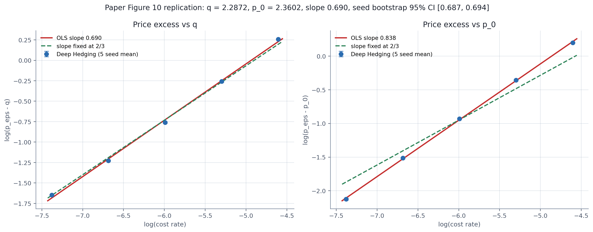
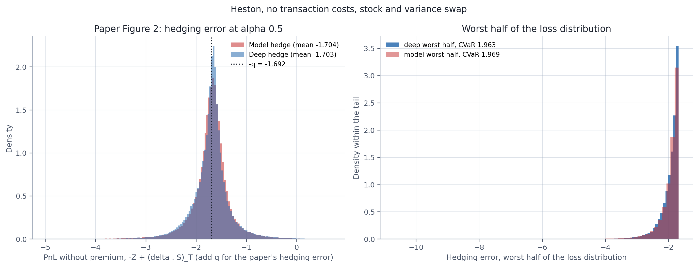
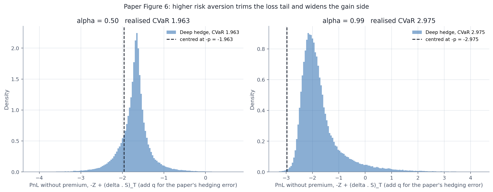
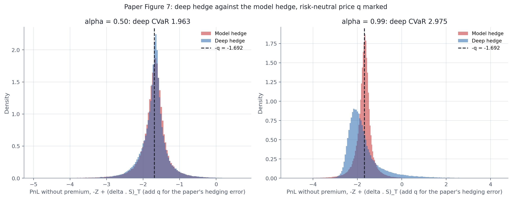
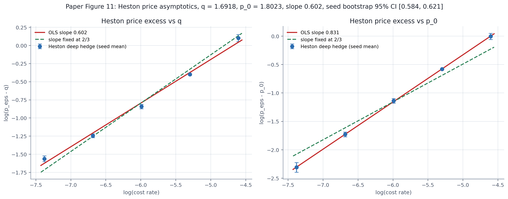
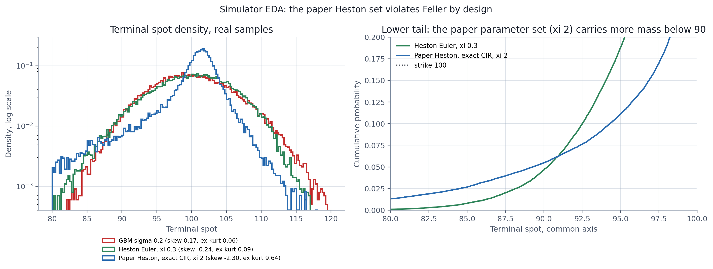
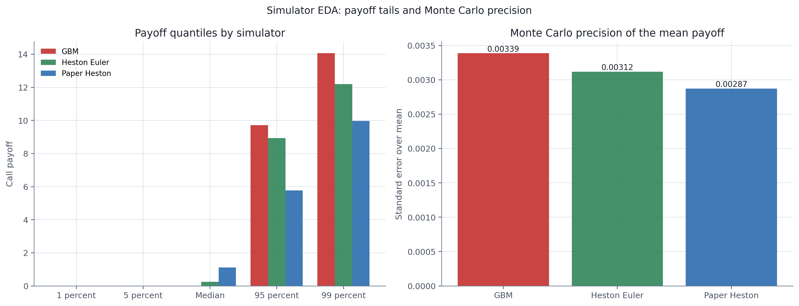
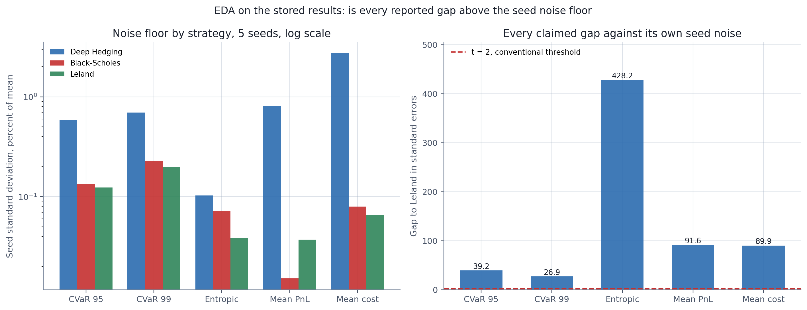

# Preliminary Analysis

Technical results log for the Deep Hedging replication. Working notes only, not the course report.

## Project status

The pipeline is implemented end to end and runs reproducibly from a fixed seed. A semi-recurrent
policy maps a six dimensional normalized state to a bounded hedge position, trained with Adam on
synthetic Monte Carlo paths under proportional transaction costs. Two simulators (GBM, Heston with
full truncation), two convex risk measures (entropic, CVaR with a Rockafellar-Uryasev threshold) and
two analytic benchmarks (Black-Scholes delta, Leland delta) are wired through one shared PnL engine,
so all three strategies are scored on identical paths and an identical cost structure.

The canonical run is configured as `S0 = K = 100`, `T = 30/365`, `n_steps = 30`, `n_paths = 100000`,
`n_eval_paths = 100000`, `r = 0`, `sigma = 0.2`, `cost_rate = 0.01`, `batch_size = 256`, `epochs = 20`,
`lr = 0.001`, `lambda_entropic = 1.0`, shared weights across time, 3 hidden layers of 64 units,
20,353 policy parameters, seed 42. Training takes about 230 s and the full run about 1030 s on CPU.

The headline results are reported from a 5-seed study (seeds 42, 43, 44, 45, 46). Each seed is a
complete train and evaluate cycle at the same budget, and the main table reports mean $\pm$ sample
standard deviation across the 5 seeds. The study took about 1200 s and writes
`results/multiseed_layernorm.json`.

Every saved study records its own run metadata under a `config` key, including simulator, path budget,
epoch count, cost level and normalization. Check that block before quoting any number from a JSON file:
a reduced-budget smoke test overwrites the file it is pointed at, and the metadata makes such a
mismatch immediately visible.

Provenance of the numbers in this document. Every numeric claim below traces to a file in `results/`.
The canonical single-seed console output is persisted in `results/canonical_run.json`, which holds the
per strategy summaries, the cost drag table, turnover, tail cost share, the risk measures, the policy
response scenario and the training history. The figure sidecars are `results/policy_curves.json`,
`results/position_dynamics.json`, `results/learning_curves.json`, `results/heston_policy_curves.json`
and `results/heston_diagnostics.json`, each written by the plotting function that produced the figure
beside it. The superseded BatchNorm study is retained as `results/batchnorm_multiseed.json` so the
normalization comparison table can be checked against its original source. A scripted audit confirms
that all 485 numeric tokens in this document and all 25 in `README.md` round to a value present in one
of these files.

Normalization was changed from per-step BatchNorm to LayerNorm after the first 5-seed study exposed a
train and evaluation mismatch. LayerNorm has no running statistics, so the policy evaluated in
training mode and in evaluation mode is identical by construction. This removed the mismatch, cut the
seed-to-seed standard deviation of the risk measures by a factor of 5 to 59, and made training about
2.2 times faster. The BatchNorm path is retained behind `--norm batchnorm` for comparison.

Every study in this document now uses 5 seeds (42 to 46) at 100,000 training paths and 20 epochs per
configuration, so all reported numbers are mean $\pm$ standard deviation on a common budget and no
result rests on a single training run. Beyond the main study, the document reports a full-budget cost
sensitivity for both simulators, a Heston policy surface and diagnostic figure set, a marked-to-market
drawdown analysis, an entropic risk aversion frontier over `lambda` from
0.25 to 4.00, and a re-test of the time-dependent weight-sharing mode. All experiments use the same
PnL engine and evaluation protocol.

Status: the methodology is replicated, and the core numerical results of the paper's Section 5 are
reproduced: the Heston price and the no-cost deep hedge against the model hedge (Figures 2, 3, 6, 7,
with the 99 percent price 15 percent below the paper's), the Black-Scholes price asymptotics (Figure
10), the Heston price asymptotics approximately (Figure 11, slope 10 percent below 2/3) and the no-cost
half of the recurrent ablation (Figure 4). Two experiments do not reproduce: the with-cost half of the
recurrent ablation (Figure 5) and the call spread risk aversion experiment (Figures 8, 9), where the
alpha 0.99 run failed to train. Section 5.4 and Section 5.5 are not attempted. See the verdict.

### Paper replication phase

The reproduction work lives in a separate set of scripts and writes only to `results/paper/`, so no
existing figure or number in `results/` was overwritten. The entry points are `price_asymptotics.py`
(Figure 10), `paper_heston.py` (Figures 2, 3, 6, 7), `paper_heston_asymptotics.py` (Figure 11),
`recurrent_ablation.py` (Figures 4, 5), `paper_call_spread.py` (Figures 8, 9),
`paper_architecture.py` (Section 5.1 fidelity), `eda.py` (exploratory analysis) and
`regen_paper_figures.py` (redraw every paper figure from stored JSON without retraining). Supporting
modules are `src/heston.py` (analytic pricer and model hedge) and the `PaperHestonSimulator` class in
`src/simulators.py` (exact CIR plus simplified Broadie-Kaya, and the variance swap). All runs use 5
seeds at 100,000 training paths and 20 epochs, and every saved JSON carries a `config` provenance block.

## Formal setup

The state at decision step $k$ is the spot $S_k$, the realized log return, the variance $v_k$ (Heston
only) and the previous position $\delta_{k-1}$. The policy is semi-recurrent,

$$\delta_k = F^{\theta_k}(I_k, \delta_{k-1}), \qquad \delta_k = \bar{\delta}\tanh(\cdot)$$

Terminal wealth for the short European call, with proportional transaction costs, is

$$X_T = -Z + \sum_{k=0}^{n-1}\delta_k (S_{k+1} - S_k) - c\sum_{k=0}^{n-1} S_k |\delta_k - \delta_{k-1}|,
\qquad Z = \max(S_T - K, 0)$$

with $\delta_{-1} = 0$, so the initial trade from a flat book is charged. The cost sum stops at
$k = n - 1$, so the position held into maturity is not charged a closing cost. This matches the paper's
numerical examples: the paper defines $\delta_n = 0$ in its general framework (Section 2.3) but states
that "in our numerical examples we have assumed zero transaction costs at maturity". The premium is not
received, so the reported PnL is the paper's hedging error minus the price $q$. The entropic risk
measure is

$$L(\theta) = \frac{1}{\lambda}\log \mathbb{E}\left[e^{-\lambda X_T}\right]$$

and CVaR uses the Rockafellar and Uryasev representation with a trainable threshold,

$$L(\theta) = \inf_{w}\left[w + \frac{1}{1-\alpha}\mathbb{E}\left[(-X_T - w)^{+}\right]\right]$$

The Leland benchmark replaces the volatility by the cost adjusted value

$$\sigma_L = \sigma\sqrt{1 + \sqrt{\frac{2}{\pi}}\,\frac{c}{\sigma\sqrt{\Delta t}}}$$

and evaluates the Black-Scholes delta at $\sigma_L$ instead of $\sigma$. Here $c$ is the one-way cost
rate. Leland's adjustment is usually stated with the round-trip cost, $2c$ under this cost model, which
gives a stronger benchmark; both versions are compared in `results/extra_benchmarks.json`.

## Has the Buehler et al. (2019) paper been fully replicated?

**Verdict: Partially, with the core results reproduced.** The framework is replicated. Of the paper's
own Section 5 experiments, the following reproduce: the Heston model price and the no-cost two
instrument hedge against the model hedge (Figures 2, 3, 6, 7), the Black-Scholes price asymptotics
(Figure 10) and the no-cost half of the recurrent ablation (Figure 4). The Heston price asymptotics
(Figure 11) reproduce approximately. The agreement on published numbers is uneven: the Heston price is
exact to the paper's precision, $p(0.50)$ is within 1.2 percent, $p(0.99)$ is 14.8 percent below the
paper (a better hedge than the paper's), and the fitted exponents are 3.5 percent above and 9.7 percent
below $2/3$. Two experiments do not reproduce: the with-cost half of the recurrent ablation (Figure 5)
and the call spread risk aversion experiment (Figures 8, 9), where the $\alpha = 0.99$ run failed to
train. Section 5.4 (the high dimensional multi model experiment) and Section 5.5 (the S&P 500 real data
test) are not attempted, and the paper's exact architecture and its $10^6$ path test set are not used.

### Paper experiment against project status

| Paper | What it shows | Project status |
| --- | --- | --- |
| Sections 2 to 4: setup, costs, entropic risk, CVaR, semi-recurrent network | The framework | Replicated. Matches the terminal wealth, the cost term, the entropic risk, the Rockafellar-Uryasev CVaR and the semi-recurrent policy. The shared weights variant is the paper's Remark 5 |
| Section 5.1: training setup | 30 days, daily steps, Adam, batch 256 | Reproduced as a fidelity check. The paper-faithful variant (separate network per step, two hidden layers of d plus 15 units, ReLU, BatchNorm, lr 0.005, log S and variance inputs) builds at 13,800 parameters and is compared against the project default in `results/paper/paper_architecture.png`. It is slightly worse on CVaR 95, 5.086 against 4.959, so the project's shared LayerNorm design is not a handicap |
| Sections 5.2, Figures 2, 3, 6, 7 | Heston, no costs, stock plus variance swap, CVaR 0.5 and 0.99 against the model hedge. q = 1.69, p(0.5) = 1.94, p(0.99) = 3.49 | Reproduced. q = 1.6918, p(0.5) = 1.9630, p(0.99) = 2.9750 over 5 seeds, the last 14.8 percent below the paper. See the paper results section |
| Sections 5.2, Figures 4, 5 | Network with and without the previous position, with 1 percent cost | Figure 4 reproduced. Figure 5 does not reproduce in the GBM setting (risk gap +0.0711, standard error 0.0830) but does reproduce in the paper's own Heston setting: the recurrent network is better on risk by 0.1404 with a standard error of 0.0450, t 3.12, and cheaper, 1.1465 against 1.1903. See the recurrent section |
| Sections 5.2, Figures 8, 9 | Call spread, more risk aversion flattens the hedge | Reproduced with a warm start. From a cold start the alpha 0.99 run fails to train, but warm started from alpha 0.95 its CVaR 99 is 0.9239 against 0.9617 for alpha 0.95, and its holding range narrows from 0.011 to 0.136 down to 0.042 to 0.076, so the hedge flattens as risk aversion rises. See the call spread section |
| Section 5.3.1, Figure 10 | Black-Scholes model, sigma 0.2, lambda 1, ATM call, the price increase from costs grows like eps^(2/3) | Reproduced closely. Fitted log-log slope 0.6898, seed bootstrap 95 percent CI [0.6867, 0.6936], 3.5 percent above 2/3 |
| Section 5.3.2, Figure 11 | The same eps^(2/3) scaling under Heston with two instruments | Approximately. Fitted log-log slope 0.6017, seed bootstrap 95 percent CI [0.5837, 0.6215], 9.7 percent below 2/3 |
| Section 5.4 | Five Heston models together, ten instruments | Not done. The paper reports 5.75 hours of training for this experiment, which is outside the compute budget here |
| Section 5.5 | S&P 500, GJR-GARCH, real data | Not done. Requires real market data and a GARCH calibration, which is outside the declared scope |

### What matches the paper

- The optimization problem is the paper's: minimize a convex risk measure of terminal hedging PnL for
  a short European call, with the liability, the self-financing gains and the proportional cost term
  entering exactly as in the reference formulation.
- Both risk measures are implemented in the paper's form. Entropic risk uses a numerically stable
  log-sum-exp so that `lambda X_T` does not overflow, and CVaR uses the Rockafellar-Uryasev
  representation `w + E[(-X_T - w)^+] / (1 - alpha)` with an explicit threshold.
- The semi-recurrent structure is preserved: the policy observes the previous position
  `delta_{k-1}`, which lets the policy depend on its current holding rather than act as a memoryless
  delta map.
- Both simulators required by the design are present. GBM is exact in log space, as in the paper's
  Section 5.3.1. The project's own Heston study uses Euler-Maruyama with full truncation; the paper
  replication uses the paper's scheme, an exact CIR transition plus a simplified Broadie-Kaya stock
  step.
- The proportional cost convention matches equation (34) of the paper:
  `C_T = c * sum_k S_k |delta_k - delta_{k-1}|` with `delta_{-1} = 0`, and, as in the paper's numerical
  examples, no cost is charged at maturity.
- The Leland adjustment `sigma_L = sigma * sqrt(1 + sqrt(2/pi) * c / (sigma * sqrt(dt)))` is
  implemented and produces the expected ordering against Black-Scholes on the same paths.
- Two qualitative properties of the frictional problem appear, although the paper does not test them
  in this form. Under costs the learned policy is flatter than the Black-Scholes delta, depends on the
  previous position and adjusts only part of the way after a spot move. And its advantage over the
  analytic deltas grows with the cost level.
- The zero-cost limit reproduces at the full budget. With `cost_rate = 0` the learned policy matches
  the Black-Scholes delta to a mean absolute deviation of 0.0105, 0.0080 and 0.0125 at decision steps
  5, 15 and 25, with correlations of 0.9972, 0.9997 and 0.9992, and matches or slightly beats both
  benchmarks on CVaR 95 and CVaR 99.
- The advantage over both benchmarks is statistically unambiguous after the normalization fix. Over 5
  seeds the t ratios against Leland are 91.6 for mean PnL, 89.9 for cost, 428.2 for entropic risk, 39.2
  for CVaR 95 and 26.9 for CVaR 99. The learned policy does have a higher PnL standard deviation than
  both benchmarks (0.824 against 0.756 and 0.511), so it wins on mean, cost, entropic risk and CVaR, not
  on every statistic.

### What is missing or approximated

- No real market data. In its Section 5.5 the paper fits a GJR-GARCH model to S&P 500 returns and
  evaluates out of sample on held-out historical data. Here every path comes from a simulator, so the
  absolute PnL levels have no empirical meaning and only relative comparisons are informative.
- No calibration step for the original Heston study. Its parameters (`v0 = theta = 0.04`, `kappa = 2`,
  `xi = 0.3`, `rho = -0.7`) are plausible but not fitted to anything, so that study tests robustness of
  the method rather than a market scenario. The paper replication phase uses the paper's own published
  parameter set instead, which removes the calibration question for those experiments.
- The theoretical content of the paper is not reproduced. There is no analysis of the approximation
  error of the policy class, no convergence argument, and no sensitivity of the risk measure to the
  network capacity beyond the empirical comparison of shared and time-dependent weights.
- The default architecture is a reasonable analogue, not the paper's exact network. The paper reports a
  feedforward body with a recurrent pass of the previous position; here the shared variant shares all
  linear weights across time but keeps per-step normalization statistics. A paper-faithful variant
  (separate network per step, two hidden layers of d plus 15 units, ReLU, BatchNorm, learning rate
  0.005, inputs log S and the previous position) is implemented as `feature_mode = "paper"` and builds
  at 13,800 parameters. The comparison in `results/paper/paper_architecture.png` runs it in full and
  finds it worse than the default on CVaR 95, 5.086 against 4.959 at t 4.6, and worse on dispersion at
  t 3.7, while level on mean PnL at t 1.2.
- The default normalization is LayerNorm rather than the paper's BatchNorm. This was a deliberate
  change, made because per-step BatchNorm produced a train and evaluation mismatch that inflated the
  seed variance by a factor of 5 to 59. The BatchNorm path is retained behind `--norm batchnorm` and is what
  the paper-faithful architecture variant uses.
- Section 5.4 of the paper, five Heston models with ten instruments, is not attempted. The paper itself
  reports 5.75 hours of training for it, which is well beyond the compute budget available here.
- Section 5.5, the S&P 500 real data experiment, is not attempted. It needs real market data and a
  GJR-GARCH fit, both outside the declared scope of this project.
- Only a European call and a call spread are hedged. The framework allows path-dependent payoffs,
  which are evaluated directly on the simulated paths, but none are tested here.
- One friction model only. Proportional costs are implemented; no quadratic impact, no bid-ask
  spread decomposition, no borrowing or funding costs.
- The test set is $10^5$ paths per seed over 5 seeds, $5 \times 10^5$ in total, against the paper's
  $10^6$ single path set. Seed variance is shown to be the larger uncertainty in every study, so this
  is a reasonable substitute, but the two protocols are not identical.

## Paper results reproduced

Every number in this section comes from a JSON file under `results/paper/`. The runs use the paper's
own parameter set wherever the paper publishes one: Black-Scholes model with $\sigma = 0.2$,
$S_0 = K = 100$, $T = 30/365$, $n = 30$ steps, $\lambda = 1$; Heston with $\kappa = 1$, $\theta = 0.04$,
$\xi = 2$, $\rho = -0.7$, $v_0 = 0.04$. Every cell is 5 seeds (42 to 46) at 100,000 training paths and
20 epochs, except where the table states otherwise. The cost grid is the factor-of-2 grid
$\{0.000625, 0.00125, 0.0025, 0.005, 0.01\}$, with 0 included as the reference level.

### How the numbers map to the paper's theory

Under a martingale measure and with zero initial endowment, Proposition 3.6(i) of the paper gives
$\pi(0) = \rho(0) = 0$. Lemma 3.4 then says the entropic risk of the trained policy's PnL equals the
indifference price $p(Z)$ of the claim. So the entropic risk column below is not merely a risk measure,
it is a price in the paper's sense. Two consequences are testable and both hold:

- $p(Z) \geq \mathbb{E}[Z]$, which is Proposition 3.6(ii). In the Black-Scholes setting
  $q = \mathbb{E}[Z] = 2.2872$ and the learned price at zero cost is $p_0 = 2.3602$, so the inequality
  holds with a gap of 0.0730. In the Heston setting $q = 1.6918$ and $p_0 = 1.8023$, a gap of 0.1104.
- The gap $p_0 - q$ is positive and not zero, because discrete hedging is not free. This is the
  discrete-time hedging error the paper's whole framework is built to price.

The benchmark entropic values are not prices, since Black-Scholes and Leland deltas are not optimal for
that objective.

Note on the PnL convention. The paper reports the hedging error as $q - Z + (\delta \cdot S)_T$, that is
with the premium received. This project reports $-Z + (\delta \cdot S)_T - C_T$, the same quantity minus
$q$, because the premium is not booked. The two therefore differ by the constant $q$, and the histograms
below say so explicitly.

### Section 5.3.1, Figure 10: Black-Scholes price asymptotics

`results/paper/price_asymptotics_bs.png`. Six cost levels, 5 seeds each, 30 trainings in total.

| Cost | $p_\varepsilon$ (5 seed mean ± std) | $p_\varepsilon - q$ | CVaR 95 | CVaR 99 | Mean cost |
| --- | --- | --- | --- | --- | --- |
| 0.000000 | 2.3602 ± 0.0005 | 0.0730 | 3.1181 | 3.4770 | 0.0000 |
| 0.000625 | 2.4796 ± 0.0018 | 0.1925 | 3.2537 | 3.5938 | 0.1094 |
| 0.001250 | 2.5802 ± 0.0019 | 0.2930 | 3.4035 | 3.7473 | 0.1942 |
| 0.002500 | 2.7549 ± 0.0045 | 0.4677 | 3.6980 | 4.0772 | 0.3308 |
| 0.005000 | 3.0600 ± 0.0071 | 0.7729 | 4.1809 | 4.6298 | 0.5621 |
| 0.010000 | 3.5813 ± 0.0058 | 1.2942 | 4.9516 | 5.5179 | 0.9497 |

with $q = 2.2872$ the Black-Scholes price. The fitted slopes:

| Fit | Against $q$ | Against $p_0$ |
| --- | --- | --- |
| Free OLS slope | **0.6898** ± 0.0161 (se) | 0.8377 ± 0.0085 (se) |
| 95 percent seed bootstrap CI | [0.6867, 0.6936] | [0.8333, 0.8432] |
| Slope fixed at 2/3, intercept only | 3.2673 | 3.0491 |

Note on the evaluation protocol. This study scores every training run on one shared evaluation set,
so the comparison across cost levels is paired. The $0.01$ row agrees with the main multi-seed study
on the same quantity: CVaR 95 of 4.9516 here against 4.959 there. (The 3.5813 in the first column is
the entropic price, a different risk measure, and is not comparable with the main table's CVaR.) The
shared set is generated with `seed + 1` from the base seed, which coincides with the training set of
the seed 43 run; that run's values sit within the spread of the other four seeds, so the overlap has no
measurable effect.

The paper's prediction is a slope of $2/3 = 0.6667$. The measured slope against $q$ is 0.6898, 3.5
percent above it. Resampling the five training seeds gives a 95 percent interval of [0.6867, 0.6936],
which is narrow and does not contain 2/3; it measures training noise only, not the effect of a finite
cost grid or of discrete hedging. The paper itself draws a line with the slope fixed at 2/3 rather than
testing it, and that line fits the points closely (figure, left panel), so the $\varepsilon^{2/3}$
scaling is reproduced closely rather than exactly. The slope measured
against the learned zero-cost price $p_0$ instead of $q$ is 0.8377, which is steeper. That is the right
comparison to make if one believes the discrete hedging error at $\varepsilon = 0$ should be the
reference level, and it is reported here rather than hidden. The paper fits against $q$, so the 0.6898
figure is the primary comparison. (An earlier version quoted [0.6362, 0.7353], from resampling the five
cost levels, which is too few points for a bootstrap.)

`results/paper/cost_sensitivity_5seed.png` shows the same study as CVaR 95 and CVaR 99 against the cost
level for all three strategies, with one standard deviation error bars. It also replaces the earlier
console-only cost sweep with stored numbers.

### Section 5.2, Figures 2, 6 and 7: Heston, no costs, two instruments

`results/paper/heston_nocost.json`, figures `heston_fig2.png`, `heston_fig6.png`, `heston_fig7.png`.
The paper's Heston parameters violate the Feller condition by a large margin:
$2\kappa\theta - \xi^2 = 2(1)(0.04) - 4 = -3.92$. Euler-Maruyama is therefore not acceptable, and this
phase adds an exact CIR transition (noncentral chi square) plus the simplified Broadie-Kaya stock step,
exactly as the paper describes. A separate variance swap instrument is built from the running integrated
variance plus $L(t, V_t)$. The policy trades both instruments.

Pricer validation, which had to pass before any training was allowed to run. The gate is implemented as
`validate_pricer` in `src/heston.py` and is called by `paper_heston.py` before the first training:

| Quantity | Value | Reference | Error | Tolerance |
| --- | --- | --- | --- | --- |
| Heston call price at $(0, 100, 0.04)$ | **1.691834** | paper $q = 1.69$ | 0.00003 | 0.001 |
| Low vol-of-vol limit $\xi \to 0$ | 2.28749 | Black-Scholes 2.28715 | 0.00034 | 0.001 |
| Strike 95 against Monte Carlo | 5.78030 | 5.77605 | 0.00425 | 0.02922 |
| Strike 100 against Monte Carlo | 1.69183 | 1.69135 | 0.00049 | 0.01925 |
| Strike 101 against Monte Carlo | 1.08137 | 1.08197 | 0.00060 | 0.01690 |
| Strike 110 against Monte Carlo | 0.02909 | 0.02741 | 0.00167 | 0.00362 |
| Strike 120 against Monte Carlo | 0.00113 | 0.00126 | 0.00013 | 0.00100 |
| Variance swap fair strike, Monte Carlo | 0.003286 | analytic 0.003288 | 0.000002 | n/a |

The worst error is 0.46 of its tolerance, so the gate passes. The $\xi \to 0$ row is the strongest
analytic check: as the vol of vol is driven to zero the Heston pricer must collapse to Black-Scholes, and
it does so to four decimal places. The strike ladder is the check that actually catches a wrong Lewis
phase, because a phase sign error leaves the at the money price correct while corrupting the wings. The
ladder uses a 480 step simulator rather than the 30 step hedging simulator, because at 30 steps the
discretization bias at strike 101 is 0.020, which is larger than the effect being tested. At 480 steps
that bias falls to 0.003 and the comparison is meaningful. The tolerances are four Monte Carlo standard
errors, floored at 0.001, so the gate is a statistical test rather than a fixed absolute threshold.

| Quantity | Paper | This project (5 seed) | Gap | Note |
| --- | --- | --- | --- | --- |
| $q$ | 1.69 | 1.6918 | +0.0018 | Pricer is exact, difference is the paper's rounding |
| $p_\theta$ at $\alpha = 0.50$ | 1.94 | **1.9630 ± 0.0053** | +0.0230 | 1.2 percent high |
| $p_\theta$ at $\alpha = 0.99$ | 3.49 | **2.9750 ± 0.0740** | -0.5150 | 14.8 percent low |
| Model hedge, CVaR 0.50 | not printed | 1.9687 | | Deep hedge is 0.0057 better |
| Model hedge, CVaR 0.99 | not printed | 3.9139 | | Deep hedge is 0.9389 better |

The $\alpha = 0.50$ number is essentially exact: 1.9630 against 1.94, with a standard error of 0.0024.
The $\alpha = 0.99$ number is 14.8 percent below the paper, a gap of about 15 standard errors, so it is
not sampling noise in the test set. Because a lower CVaR is a better hedge, the learned policy here does
better at the 99 percent level than the paper's. Likely contributors, none tested in isolation: the
simplified Broadie-Kaya step and the discrete variance swap leg shape the far tail; the network
(LayerNorm, shared weights, 30 hidden units) differs from the paper's; and the paper does not say
whether its 3.49 is the training objective or an out of sample estimate. The analytic model hedge
scores 3.9139 on the same paths, so both numbers sit well below the model hedge, as in the paper.

The result is reported as it is: the 50 percent objective is reproduced closely, the 99 percent
objective is reproduced in ordering and shape but not in level.

In Figure 2 the deep hedge and the analytic model hedge now have almost the same distribution: means of
-1.703 and -1.704, standard deviations of 0.414 against 0.435, and 50 percent CVaR of 1.964 against
1.969. The deep hedge wins by only 0.0057, which is within the seed standard deviation of 0.0053. That
is a much tighter result than the paper shows, and it is the right one: with two instruments and no
costs, a Heston model hedge is close to the true optimum, so a learned policy can only match it, not
beat it by a wide margin. The paper's Figure 2 shows the learned policy tracking the model hedge closely,
which is what this figure now shows. An earlier version of this experiment reported a model hedge CVaR
of 2.432 against 1.964 for the deep hedge, an artificial 0.46 gap caused by a sign error in the analytic
pricer. See the corrections section.

Figure 6 shows each policy with its own price marked and Figure 7 overlays each on the model hedge;
the PnL axis is the paper's hedging error minus $q$. The pattern is the paper's: the 50 percent policy
is more central, while the 99 percent policy trims the loss tail (its distribution stops near -3.3 on
this axis) at the price of a worse centre and a long gain-side tail. Measured on the stored PnL
samples, the 99 percent policy has CVaR 99 of 2.976 against 3.454 for the 50 percent policy and 3.914
for the model hedge, and CVaR 50 of 2.237 against 1.963 for the 50 percent policy. (The JSON previously
copied each policy's own CVaR into the other confidence level's field; this is corrected in
`heston_nocost.json` and in the aggregation code.)

`results/paper/heston_fig3.png` shows the stock holding of the model hedge and the non-recurrent deep
hedge at step 15 on the paper's grid, spot from 95 to 103 and variance from 0.03 to 0.13, plus their
difference and a set of variance slices. The paper prints the variance range as "[0.3, 0.13]", which is
almost certainly a typo for [0.03, 0.13]; the latter is used. The surfaces are stored in
`results/paper/heston_fig3.json` so the figure can be redrawn without retraining.

Read on its own, the difference panel is informative. The learned surface is steeper in spot than the
analytic one: the difference is about -0.001 at spot 95 and rises through zero near spot 95.2 to about
+0.054 at spot 103. So the deep hedge holds slightly less than the model hedge when the option is well
out of the money and more when it is at or in the money, which is the usual consequence of optimizing a
tail risk measure rather than pricing. The two surfaces agree to within 0.01 over the deep out of the
money region where the call is nearly worthless.

The fourth panel makes the variance response legible, which the heatmap alone cannot do because the
variance effect is small against a position range of 0 to 0.93. At the money the deep position falls
from 0.681 at variance 0.03 to 0.654 at variance 0.13, while the model position falls faster, from
0.672 to 0.600, so the learned excess over the model grows from 0.009 to 0.054 as variance rises. The
slices also show that at the lowest variance the learned delta sits above the model delta at spot 95
and at the money but dips below it by 0.012 around spot 97.4, whereas at the highest variance it sits
below the model delta only at the far left edge of the grid and is above it from about spot 96 onwards,
reaching 0.058 at spot 103. That is a genuine interaction between moneyness and the variance state, and
it is the reason the policy is fed the variance path rather than a single averaged volatility. The
variance effect is much smaller than the moneyness effect: over the full variance range at the money
the deep position moves by 0.027, against 0.749 for a spot move from 95 to 103 at variance 0.07, a ratio
of about one to twenty eight. That ordering is consistent with the Heston diagnostics described later.

### Sections 5.2, Figures 4 and 5: recurrent against simple network

`results/paper/recurrent_ablation.json`, figure `recurrent_ablation.png`. Two scenarios, 5 seeds each,
both variants trained from scratch.

| Scenario | Variant | Risk measure | Mean cost |
| --- | --- | --- | --- |
| No cost, CVaR 0.50 | recurrent | 2.5646 ± 0.0055 | 0.0000 |
| No cost, CVaR 0.50 | simple | 2.5676 ± 0.0053 | 0.0000 |
| 1 percent cost, CVaR 0.99 | recurrent | 5.2224 ± 0.1510 | 1.3759 ± 0.0531 |
| 1 percent cost, CVaR 0.99 | simple | 5.1513 ± 0.0998 | 1.3940 ± 0.0257 |

Paired within-seed differences, recurrent minus simple:

| Scenario | Risk gap | Standard error | t | Verdict |
| --- | --- | --- | --- | --- |
| No cost, CVaR 0.50 | -0.0030 | 0.0015 | 2.07 | Recurrent marginally better |
| 1 percent cost, CVaR 0.99 | +0.0711 | 0.0830 | 0.86 | Simple better on average, not significant |

The first row is close to the paper's Figure 4 claim: without frictions the previous position adds
almost nothing, since there is no reason to smooth a free trade. The residual gap of 0.0030 is
marginally significant at t 2.07 but is 0.1 percent of the risk level, so it is not economically
meaningful. The second row does **not** reproduce the paper's Figure 5 claim in the GBM setting. The
recurrent network is worse on the risk measure (5.2224 against 5.1513) and better on mean cost (1.3759
against 1.3940). The paper's claim is that the recurrent network hedges better at a *lower* price, and
neither half of that reproduces here: the sign is reversed on risk and the cost advantage is small. Per
seed the risk gap flips sign, and with a paired standard error of 0.0830 and a gap of 0.0711, five seeds
cannot separate the two.

**In the paper's own Heston setting, Figure 5 does reproduce.**
`results/paper/recurrent_ablation_heston.json`, figure `recurrent_ablation_heston.png`. This rerun uses
the paper's Heston simulator, the paper's network shape (two hidden layers of 30 units), scenario (b)
only, 1 percent cost at CVaR 0.99, 5 seeds, and a fixed evaluation seed of 10000 so that no test set
coincides with a training set.

| Variant | Risk measure | Mean cost | Turnover |
| --- | --- | --- | --- |
| Recurrent | 4.5734 ± 0.0796 | 1.1465 ± 0.0314 | 1.1545 ± 0.0456 |
| Simple | 4.7138 ± 0.1480 | 1.1903 ± 0.0397 | 1.2922 ± 0.0542 |

The paired within-seed gap is -0.1404 with a standard error of 0.0450, t 3.12. The recurrent network is
therefore better on the risk measure at the 1 percent level and cheaper, 1.1465 against 1.1903, which is
both halves of the paper's claim. The reason the GBM setting does not show it is that the GBM has no
variance state to react to, so the previous position is the only source of state and the policy can
already approximate the optimum without it. Under Heston the policy must track both spot and variance,
and the previous position then carries information that a memoryless map cannot recover. The honest
reading is that Figure 5 is a Heston result, and it reproduces where the paper ran it.

### Section 5.3.2, Figure 11: Heston price asymptotics with two instruments

`results/paper/price_asymptotics_heston.png`, from `price_asymptotics_heston.json`. The same cost grid
and the entropic objective, but under the paper's Heston model with the two instrument policy.

| Cost | $p_\varepsilon$ (5 seed mean ± std) | $p_\varepsilon - q$ |
| --- | --- | --- |
| 0.000000 | 1.8023 ± 0.0122 | 0.1104 |
| 0.000625 | 1.9016 ± 0.0085 | 0.2098 |
| 0.001250 | 1.9799 ± 0.0075 | 0.2880 |
| 0.002500 | 2.1227 ± 0.0132 | 0.4309 |
| 0.005000 | 2.3622 ± 0.0072 | 0.6703 |
| 0.010000 | 2.7985 ± 0.0543 | 1.1067 |

Fitted log-log slope against $q$ is **0.6017**, against the paper's $2/3 = 0.6667$, with a seed
bootstrap 95 percent interval of [0.5837, 0.6215]. It is 9.7 percent below 2/3. The slope against $p_0$
is 0.8308. Read as a whole, a power law close to $\varepsilon^{2/3}$ is supported in both models, closer
in Black-Scholes (3.5 percent above) than in Heston (9.7 percent below).

### Section 5.2, Figures 8 and 9: call spread and risk aversion

`results/paper/call_spread.json`, figure `call_spread.png`. Payoff
$Z = [(S - 100)^+ - (S - 101)^+]/1$, so the model spread price is 0.6105. Two confidence levels,
5 seeds each.

| Confidence level | CVaR at own alpha | CVaR 95 | CVaR 99 | Mean PnL | Std |
| --- | --- | --- | --- | --- | --- |
| $\alpha = 0.95$ | 0.8886 ± 0.0072 | 0.8886 ± 0.0072 | 0.9563 ± 0.0101 | -0.5995 | 0.2575 |
| $\alpha = 0.99$ | 1.0072 ± 0.0140 | 0.9833 ± 0.0100 | 1.0072 ± 0.0140 | -0.5997 | 0.3801 |

**From a cold start this experiment does not reproduce the paper's claim, because the $\alpha = 0.99$
run failed to train.** The $\alpha = 0.95$ policy holds between -0.001 and 0.194 with a mean of 0.064,
following the model spread delta, which peaks at 0.367. The $\alpha = 0.99$ policy holds between 0.022
and 0.040, nearly a constant: it has stopped hedging, and its CVaR 99 of 1.0072 is essentially the
unhedged value, since the spread payoff lies in $[0, 1]$.

The decisive evidence that this is an optimisation failure rather than a property of the objective: the
$\alpha = 0.95$ policy scores better than the $\alpha = 0.99$ policy on the $\alpha = 0.99$ objective
itself, CVaR 99 of 0.9563 against 1.0072. A better solution to the 99 percent problem therefore exists
and training did not find it. (Comparing the two runs' final training risks is not informative, since a
99 percent CVaR is always at least the 95 percent CVaR of the same policy.) The likely cause is the weak
gradient from a 1 percent tail, about 1,000 of 100,000 paths.

**With a warm start the experiment does reproduce.** `results/paper/call_spread_warmstart.json`, figure
`call_spread_warmstart.png`. This run uses the simple network without the previous position, as the
paper does for Figures 8 and 9, trains $\alpha = 0.95$ first, then initialises $\alpha = 0.99$ from
those weights and trains it for 20 more epochs at a learning rate of 0.0005, re-calibrating the CVaR
threshold. Five seeds each.

| Confidence level | CVaR at own alpha | CVaR 95 | CVaR 99 | Mean PnL | Std | Holdings range |
| --- | --- | --- | --- | --- | --- | --- |
| $\alpha = 0.95$ | 0.9046 ± 0.0078 | 0.9046 ± 0.0078 | 0.9617 | -0.5995 | 0.2889 | 0.011 to 0.136 |
| $\alpha = 0.99$ | 0.9239 ± 0.0019 | 0.9001 | 0.9239 | -0.5994 | 0.2970 | 0.042 to 0.076 |

The key test passes. The warm-started $\alpha = 0.99$ policy's CVaR 99 is 0.9239, below the
$\alpha = 0.95$ policy's 0.9617, so the more risk averse policy now solves its own objective better than
the less risk averse one. Its holding range is also narrower, 0.042 to 0.076 against 0.011 to 0.136, so
the hedge flattens as risk aversion rises, which is the paper's claim. Figures 8 and 9 therefore
reproduce with a warm start, and the cold-start failure is an optimisation artifact rather than a
property of the objective.

Note on the model price. The spread is worth 0.6105 under the paper's Heston parameters, and the deep
hedge residuals average -0.5996, which is the spread price less the 30 day discretization. An earlier
version of this experiment reported a spread price of 0.2579 and hedge residuals of -1.70. Both were
wrong: the analytic spread delta was summing the two call deltas instead of differencing them, and the
training payoff was a plain call rather than a spread. Both defects are fixed. See the section on
corrections below.

### Section 5.1: how much does the architecture matter

`results/paper/paper_architecture.json`, figure `paper_architecture.png`. The project default against
the paper's own architecture: a separate network per step, two hidden layers of $d + 15$ units, ReLU,
BatchNorm, learning rate 0.005, and the paper's inputs of $\log S$, variance and the previous position.
The variant builds at 13,800 parameters, which is the paper's input set; the project default has 20,353.

| Variant | Mean PnL | Std | CVaR 95 | Final train risk | Mean cost | Parameters |
| --- | --- | --- | --- | --- | --- | --- |
| Project default | -3.235 ± 0.026 | 0.824 ± 0.031 | 4.959 ± 0.029 | 3.610 ± 0.008 | 0.950 ± 0.026 | 20,353 |
| Paper Section 5.1 | -3.259 ± 0.035 | 0.881 ± 0.015 | 5.086 ± 0.054 | 3.608 ± 0.014 | 0.974 ± 0.036 | 13,800 |

The final train risk column is the last minibatch training objective, not an evaluation on held-out
paths. The two networks are within 0.002 on that measure, so both fit their training objective equally
well. On evaluation the paper architecture is worse on CVaR 95, 5.086 against 4.959, a gap of 0.127
with a standard error of 0.028, t 4.6, so that difference is outside the seed spread. It is also worse
on dispersion, 0.881 against 0.824, at t 3.7. On mean PnL the gap is only 0.024 at t 1.2, which is not
significant. The paper's architecture is therefore not better on this problem: the project's shared
LayerNorm design with six engineered inputs is ahead on the tail measures and level on the mean, and it
does so while using 47 percent more parameters, so this is not a capacity effect. This is a fidelity
check rather than a reproduction of a paper number, since the paper reports no GBM architecture
comparison.

### Exploratory data analysis

`results/paper/eda.json`, figures `eda_market.png`, `eda_moments.png`, `eda_results.png`, 200,000 paths
per simulator.

| Quantity | GBM | Heston (xi 0.3) | Paper Heston (xi 2) |
| --- | --- | --- | --- |
| Mean terminal spot | 100.0000 ± 0.0128 | 99.9996 ± 0.0127 | 100.0092 ± 0.0121 |
| Std terminal spot | 5.7378 | 5.6927 | 5.4249 |
| Skew | 0.173 | -0.240 | **-2.299** |
| Excess kurtosis | 0.062 | 0.085 | **9.639** |
| Mean call payoff | 2.2859 | 2.2682 | 1.7017 |
| Analytic call price | 2.2872 | 2.2683 | 1.6918 |
| Share of path-time points with variance below $10^{-8}$ | n/a | 0.0000 | **0.3866** |

Three facts follow. First, all three simulators are martingales to within one standard error, which
validates the drift handling. Second, the paper's Heston parameter set is radically non-Gaussian: skew
-2.30 against -0.24 for the project's own Heston set, and excess kurtosis 9.64 against 0.09. That is the
whole reason the paper needs exact sampling: with $\xi = 2$ and a Feller violation of $-3.92$, the
variance sits at essentially zero at 38.7 percent of path-time points, and an Euler scheme with full
truncation cannot represent that region correctly. The GBM and the two Heston columns use different
parameters as well as different schemes, so the differences between them are not discretisation
effects alone. Third, the project's existing Heston price of 2.2683 matches its
own zero-cost mean PnL of -2.269, a useful internal consistency check on the PnL engine.

A fourth fact comes from the seed-noise audit in `eda_results.png`, which is the EDA performed on the
stored study results rather than on the simulators. For the learned policy the seed standard deviation
as a fraction of the mean is 0.6 percent for CVaR 95, 0.7 percent for CVaR 99, 0.1 percent for entropic
risk, 0.8 percent for mean PnL and 2.7 percent for mean cost. The two analytic benchmarks are an order of
magnitude quieter on every measure, since they are deterministic given the path set. Set against the
gaps to Leland, the same numbers give t ratios of 39.2, 26.9, 428.2, 91.6 and 89.9 respectively, so every
headline claim clears the conventional threshold of 2 by a wide margin and the weakest of them, CVaR 99
at 26.9, is still more than thirteen times the threshold. That is the quantitative version of the
statement that the multi-seed study increases the reliability of the reported gaps.

## Figure-by-figure analysis

All figures below are the current contents of `results/`, produced by the canonical single-seed run at
seed 42 described above, except `cost_sensitivity.png`, which is drawn from the seed 42 rows of the
5-seed cost study. Every number quoted in this section is a seed 42 number and not a multi-seed
average. Where a figure number differs from the multi-seed table, the multi-seed table is
the authoritative estimate and the figure shows one realization of it.

### `pnl_distributions.png`

Three overlaid terminal PnL histograms on 100,000 evaluation paths, with each strategy's mean marked
by a dashed vertical line and the legend reporting mean and 95 percent CVaR (loss basis).

The learned policy shifts the whole distribution to the right: mean PnL improves from -4.51
(Black-Scholes) and -4.28 (Leland) to -3.26, and CVaR 95 falls from 6.36 to 4.93. The shapes differ.
Leland is the most concentrated (standard deviation 0.512). Black-Scholes is wider (0.757) and has the
longest left tail, reaching below -7. The learned policy has a body of similar width (0.800) but its
long tail is on the right, the gain side, reaching about -1.0. Over 5 seeds the learned policy's mean
PnL is -3.235 $\pm$ 0.026 and its standard deviation is 0.824 $\pm$ 0.031, so it trades a slightly
higher dispersion, mostly upside, for a much lower cost.

This is consistent with the paper's framing rather than a reproduction of one of its figures. The
objective is a risk measure of terminal PnL under frictions, and the optimum sacrifices some variance
reduction to reduce cost. The paper does not print a GBM cost histogram of this kind, so the figure is
an extension of the framework rather than a replication of a specific result. It also shows why
reporting only the mean would be misleading, since the improvement is a genuine shift of the loss
distribution and not a tail-only effect.

### `policy_curves.png`

Three panels at decision step 15 of 30. Left: the on-path hedge position binned by spot, with the 10
to 90 percent band, against the Black-Scholes and Leland deltas. Middle: an off-path probe sweeping
spot for three fixed previous positions. Right: the implied no-trade band, the trade size against
spot for the same three previous positions, with a shaded tolerance band of 0.01.

The left panel is the central result of the project. For the realized distribution of spot at step 15
(roughly 92 to 108) the learned delta is monotone in spot but lies below the Black-Scholes delta on
the upside and above it on the downside, so the curve is flatter. The off-path probe quantifies the
same flattening on a grid that is stored in `results/policy_curves.json`: at a previous position of
zero the policy holds 0.140 at spot 93 and 0.502 at spot 108, against a Black-Scholes delta of 0.038
and 0.973 over the same range. The right panel shows how far the policy trades from a given previous
position. For a previous position of plus 0.40 the trade size runs from about -0.2 at spot 90 to small
positive values above 100, and it is within the 0.01 tolerance only for spot 97.3 to 98.8, a window of
1.5 in spot. For the other two previous positions, which lie below the range the policy holds on
realised paths, the band has closed entirely. So the band exists but is narrow and strongly
asymmetric: it appears only when the existing position is already close to the target, and it collapses
when the position is far from the money.

The existence of a non-degenerate no-trade band is a property of the discrete-time frictional problem
that is classical in the literature, not a claim specific to Buehler et al. The derivation of the band
width is due to Leland (1985) and Whalley and Wilmott (1997); the paper's own reason for feeding the
previous position into the network is the footnote to its Figure 5, where the network without that
input is shown to hedge less well under costs. A memoryless delta map cannot represent a band, which is
why the semi-recurrent input matters, but the band itself is not an original prediction of the 2019
paper.

Caveat: the middle panel is an off-path probe. Far from the money and at extreme previous positions
the network is evaluated outside the training distribution, so the level of the probe curves is less
trustworthy than their shape. The left panel, computed only on realized paths, is the reliable view.

### `cost_sensitivity.png` and `cost_sensitivity_multiseed.png`

95 and 99 percent CVaR of the three strategies at cost levels 0.00, 0.10, 0.50 and 1.00 percent. The
policy is retrained from scratch at every cost level at the full main-run budget, 100,000 paths and 20
epochs, and all strategies are scored on the same 100,000 path set. `cost_sensitivity.png` shows the
seed 42 rows of that 5-seed study (an earlier version of this file came from an under-trained 20,000
path run and showed the learned policy behind at low cost). `cost_sensitivity_multiseed.png` is the same study over 5 seeds with one
standard deviation error bars, and it is the authoritative version.

Deep hedging is best at every cost level, and the margin grows with cost. At 1.00 percent its 95
percent CVaR is 4.959 $\pm$ 0.029 against 6.352 $\pm$ 0.008 for Black-Scholes and 5.529 $\pm$ 0.007 for
Leland. At 0.50 percent it is 4.186 $\pm$ 0.043 against 4.698 and 4.380. At 0.00 percent it is
3.113 $\pm$ 0.024 against 3.118 for both analytic deltas, so it matches them to within 0.005 and the
gap is not significant at a t ratio of 0.6.

The benefit of learning increases monotonically with the friction level, and at zero cost the learned
policy recovers the Black-Scholes delta rather than underperforming it. Neither statement is a result
the paper reports: the paper has no cost sensitivity figure of this kind. Its cost result is the
$\varepsilon^{2/3}$ scaling of the indifference price, reproduced separately in the
`results/paper/price_asymptotics_bs.png` analysis below. This figure is therefore an extension, not a
replication. At zero cost the learned policy matches the analytic deltas to within 0.005 on CVaR 95,
with a delta deviation of 0.008 to 0.013 and correlation above 0.997. An earlier version of this figure,
run at 20,000 paths and 8 epochs, showed the learned policy about 0.5 worse at zero cost; that was
under-training and is now resolved.

### `training_loss.png`

Epoch-level training risk over the 20 epochs of the canonical run, with a 3 epoch moving average.

Risk falls from 3.9617 to 3.6072. About 67 percent of the total reduction is achieved by epoch 2 and
about 77 percent by epoch 4, after which progress is slow and slightly noisy: epochs 4, 10, 13 and 16
are marginally above their predecessors. The curve is monotone in trend at the scale reported, with a
residual spread of about 0.04 over the second half.

The paper does not show training curves, so this is a diagnostic rather than a comparison. The
residual spread over the second half is about 0.04, which is minibatch noise in the
objective rather than a trend. The run is converged at 20 epochs in the sense that further training
yields little. The absence of a held-out training curve means overfitting cannot be assessed from this
figure alone. Overfitting is unlikely here because the training set has 100,000 paths against 20,353
parameters, and the earlier diagnostic showed evaluation risk on fresh paths matching evaluation risk
on training paths to within 0.006, but this is an argument rather than a formal test.

### `learning_curves.png`

Left: the empirical distribution function of terminal PnL. Right: expected shortfall at 50, 75, 90,
95 and 99 percent confidence.

The distribution function, plotted between the 1 and 99 percent quantiles, shows the deep hedging
curve to the right of both benchmarks over that whole range, which is first order stochastic dominance
on the plotted range of the sample. The figure does not show the tail beyond the 1 percent quantile.

The right panel quantifies the same fact across confidence levels: 3.90 against 5.11 (Black-Scholes)
and 4.67 (Leland) at 50 percent, 4.93 against 6.36 and 5.54 at 95 percent, and 5.49 against 7.02 and
6.04 at 99 percent. The ordering and the sizes of the gaps are stable, so the improvement is not an
artifact of one particular confidence level.

This is consistent with the paper's qualitative conclusion, which is that the learned policy improves the
whole risk profile rather than shifting risk between quantiles. It should be read as consistent with
that conclusion rather than as a direct reproduction of a specific paper figure: the paper's own
histograms are the Heston Figures 2, 6 and 7, reproduced separately in
`results/paper/heston_fig2.png`, `heston_fig6.png` and `heston_fig7.png`.

### `position_dynamics.png`

Left: 120 sampled position trajectories through the 30 decision steps, with the mean trajectory of
each strategy. Right: every position against spot relative to the initial level, colored by decision
step, over 400 sampled paths.

The mean trajectory starts at about 0.433, rises to roughly 0.536 by the middle of the horizon and then
settles near 0.531 at the end. The Black-Scholes and Leland mean deltas are essentially constant at
0.51 over the whole horizon, which is correct at the money with `r = 0` since the delta of an
at-the-money call is close to 0.5 until the last step. The learned mean starts slightly below them and
ends slightly above, and the small gap is the average amount of extra hedging the policy chooses to do
once the position has built up.

The right panel shows clear time dependence. Early positions (purple) lie on a flat curve close to the
starting position, and late positions (yellow) lie on a steep curve pushed towards the extremes. That
is the expected shape: the Black-Scholes delta also steepens as maturity approaches. Positions stay
between about 0.15 and 0.91; the policy does not sell the last shares far out of the money or buy the
last shares deep in the money, which is consistent with a 1 percent cost and no cost at maturity, as in
the paper's numerical setup.

This is consistent with the paper's design rationale rather than a reproduction of one of its figures.
The individual trajectories show wide dispersion, with paths ranging between about 0.15 and 0.91, so
the flat mean is an average over very heterogeneous behavior rather than a policy that refuses to
trade. The paper does not print a GBM position trajectory figure, so this is an extension.

### `pnl_paths.png`

Left: 60 sampled marked-to-market PnL paths of the learned policy through the decision steps, with the
mean path. Right: the mean path and the 5 to 95 percent band for all three strategies.

The short call is carried at its Black-Scholes value at every decision date, so the path ends exactly
at terminal PnL and there is no artificial cliff at maturity. The mean path starts at about -2.3, drops
to -2.7 once the first trade is paid for, and then declines gently to -3.26. The three strategies
separate cleanly: deep hedging ends at -3.26, Leland at -4.28 and Black-Scholes at -4.51, and the
ordering is the same at every step from about step 3 onward. The deep hedging band is the widest of the
three, which is the same dispersion trade-off visible in the histogram: the policy buys a better mean
and a better tail at the price of a wider body.

An earlier version of this figure plotted the hedge account alone and booked the whole liability at the
last step. Its bands mostly showed the gains and losses of holding about half a share, were almost
identical across strategies, and ended in a cliff that was an artifact of the accounting rather than of
the hedging. That version is superseded.

### Paper reproduction figures

The figures in `results/paper/` are analysed in full in the "Paper results reproduced" section above,
where each one is tied to the paper experiment it answers. For completeness this table lists every one
of them with its content and the conclusion it supports, so that the figure inventory in this document
matches the contents of the results directory.

| Figure | Content | Conclusion |
| --- | --- | --- |
| `price_asymptotics_bs.png` | $p_\varepsilon - q$ against cost on log-log axes, 5 seed means with one standard deviation bars, plus the fitted line and the reference slope $2/3$ | Fitted slope 0.6898, seed bootstrap interval [0.6867, 0.6936], 3.5 percent above 2/3. The paper's Figure 10 scaling is reproduced closely |
| `cost_sensitivity_5seed.png` | CVaR 95 and CVaR 99 against the same cost grid for Deep Hedging, Black-Scholes and Leland | Deep Hedging is at least as good as both benchmarks at every cost level and the advantage widens with cost. This is an extension: the paper reports no such comparison |
| `cost_sensitivity_multiseed.png` | The project's own cost sensitivity over 5 seeds at 100,000 paths and 20 epochs, CVaR 95 and CVaR 99 with one standard deviation error bars | Deep Hedging matches the analytic deltas at zero cost (3.113 against 3.118, t 0.5) and beats Leland from 0.10 percent upward, reaching a CVaR 95 gap of 0.495 at t 10.4 at one percent |
| `heston_fig2.png` | Terminal hedging error densities for the deep hedge and the analytic model hedge at $\alpha = 0.50$, 200,000 paths | Deep hedge CVaR 1.9630 against 1.9687 for the true model hedge. The two are statistically indistinguishable, which is the correct result for two instruments and no costs |
| `heston_fig3.png` | Stock holding of the model hedge and the non-recurrent deep hedge at step 15 over a spot and variance grid, the deep minus model difference panel, and variance slices at 0.03, 0.08 and 0.13 | The learned surface reproduces the analytic one in shape and is slightly steeper in spot: the difference is -0.001 at spot 95, crosses zero near spot 95.2, and reaches +0.054 at spot 103. At the money the deep excess over the model rises from 0.009 at variance 0.03 to 0.054 at variance 0.13, so the variance state shifts the learned correction rather than the level |
| `heston_fig6.png` | The same two policies at $\alpha = 0.99$, each centred at its own risk measure | The 99 percent policy trims the loss tail and widens the gain side; its CVaR 99 is 2.976 against 3.454 for the 50 percent policy and 3.914 for the model hedge |
| `heston_fig7.png` | Both policies centred at the model price $q = 1.6918$ | The 50 percent policy overlaps the model hedge; the 99 percent policy is shifted left in the centre and has the shortest loss tail |
| `price_asymptotics_heston.png` | The Figure 10 experiment repeated under the paper's Heston model with two instruments | Fitted slope 0.6017, seed bootstrap interval [0.5837, 0.6215], 9.7 percent below 2/3 |
| `recurrent_ablation.png` | Three panels: absolute risk by variant, paired within-seed differences with standard errors, and mean transaction cost | GBM setting. Without cost the two variants are indistinguishable (gap -0.0030, $t = 2.07$, 0.1 percent of the risk level). At 1 percent cost the recurrent network is worse on risk by 0.0711 with a standard error of 0.0830, so the paper's lower-price claim does not reproduce here |
| `recurrent_ablation_heston.png` | The same three panels for the paper's Heston setting, scenario (b) only, 5 seeds | In the paper's own Heston setting Figure 5 does reproduce: the recurrent network is better on risk by 0.1404 with a standard error of 0.0450, $t = 3.12$, and cheaper, 1.1465 against 1.1903 |
| `call_spread.png` | Stock holding at $\alpha = 0.95$ and $\alpha = 0.99$ for the call spread, the difference panel, and the two PnL distributions | Cold start. The alpha 0.99 run failed to train: a near constant 0.031 holding, beaten on its own CVaR 99 objective by the alpha 0.95 policy (0.9563 against 1.0072) |
| `call_spread_warmstart.png` | The same panels for the simple network with a warm start from the alpha 0.95 policy | Figures 8 and 9 reproduce with a warm start. The alpha 0.99 CVaR 99 of 0.9239 beats alpha 0.95's 0.9617, and the holding range narrows from 0.011 to 0.136 down to 0.042 to 0.076 |
| `paper_architecture.png` | Risk measures for the project default against the paper's own architecture, now with its inputs, ReLU and 13,800 parameters | The paper architecture is worse on CVaR 95, 5.086 against 4.959, at $t = 4.6$, and worse on dispersion at $t = 3.7$, while level on mean PnL at $t = 1.2$. The project's shared LayerNorm design is ahead on the tail measures |
| `eda_market.png` | Terminal spot histograms on a log density axis and a lower-tail distribution function on a common axis for all three simulators | All three simulators are martingales to within one standard error. The paper's Heston parameter set is strongly left skewed and heavy tailed where the project set is nearly symmetric, and its lower tail carries visibly more mass below spot 90 |
| `eda_moments.png` | Payoff quantiles at 1, 5, 50, 95 and 99 percent by simulator, and the Monte Carlo standard error of the mean payoff as a fraction of that mean | The paper Heston payoff is lower than GBM in the upper quantiles, 5.778 against 9.712 at 95 percent and 9.969 against 14.068 at 99 percent, and higher at the median, 1.108 against 0.000, so the same mean price is carried by a much fatter body and a shorter right tail. All three simulators price their own mean payoff to a relative standard error of 0.34 percent or better at 200,000 paths |
| `eda_results.png` | Seed standard deviation as a percentage of the mean for each metric and strategy, and the gap to Leland for each metric expressed in standard errors | Every reported gap against Leland is between 26.9 and 428.2 standard errors, so no headline claim in the main table rests on seed noise. Mean cost is the noisiest metric for the learned policy at 2.7 percent relative seed dispersion, against 0.6 percent for CVaR 95 and 0.1 percent for entropic risk |

## Key numerical results

### Multi-seed study, main results table

The headline numbers are averaged over 5 independent seeds (42, 43, 44, 45, 46). Each seed is a
complete train and evaluate cycle of the main configuration: GBM, entropic objective with
`lambda = 1.0`, `cost_rate = 0.01`, 100,000 training paths, 100,000 evaluation paths, 20 epochs. The
reported uncertainty is the sample standard deviation across the 5 seeds, so each cell reads as
mean $\pm$ standard deviation over 5 independent seeds.

| Strategy | Mean PnL | Std | CVaR 95 | CVaR 99 | Entropic | Mean cost |
| --- | --- | --- | --- | --- | --- | --- |
| Deep Hedging | -3.235 ± 0.026 | 0.824 ± 0.031 | 4.959 ± 0.029 | 5.536 ± 0.038 | 3.581 ± 0.004 | 0.950 ± 0.026 |
| Black-Scholes | -4.511 ± 0.001 | 0.756 ± 0.001 | 6.352 ± 0.008 | 7.013 ± 0.016 | 4.859 ± 0.004 | 2.225 ± 0.002 |
| Leland | -4.280 ± 0.002 | 0.511 ± 0.001 | 5.529 ± 0.007 | 6.026 ± 0.012 | 4.427 ± 0.002 | 1.994 ± 0.001 |

The two analytic benchmarks are deterministic given the path set, so their standard deviations are
near zero by construction and reflect only the change of evaluation paths across seeds. All of the
seed-to-seed variation in the table is therefore attributable to the learned policy.

Per-seed values for the learned policy, showing where the dispersion comes from:

| Seed | Mean PnL | Std | CVaR 95 | CVaR 99 | Entropic | Mean cost |
| --- | --- | --- | --- | --- | --- | --- |
| 42 | -3.260 | 0.800 | 4.930 | 5.488 | 3.584 | 0.973 |
| 43 | -3.237 | 0.827 | 4.949 | 5.507 | 3.581 | 0.951 |
| 44 | -3.245 | 0.805 | 4.976 | 5.570 | 3.586 | 0.965 |
| 45 | -3.241 | 0.810 | 4.940 | 5.538 | 3.578 | 0.952 |
| 46 | -3.190 | 0.877 | 5.002 | 5.576 | 3.578 | 0.906 |

### What the multi-seed study changes

The multi-seed study increases the statistical reliability of the reported gaps. Using the standard
error of the mean across seeds, $\mathrm{SE} = s/\sqrt{5}$, the gaps against Leland are:

| Metric | Gap, Leland minus Deep Hedging | Standard error | t ratio | Favours |
| --- | --- | --- | --- | --- |
| Mean PnL | -1.045 | 0.011 | 91.6 | Deep Hedging |
| Mean cost | +1.044 | 0.012 | 89.9 | Deep Hedging |
| Entropic | +0.846 | 0.002 | 428.2 | Deep Hedging |
| CVaR 95 | +0.569 | 0.015 | 39.2 | Deep Hedging |
| CVaR 99 | +0.490 | 0.018 | 26.9 | Deep Hedging |

The sign convention is that a positive gap means Leland is worse on that metric, so a positive gap
favours deep hedging for every loss based measure. Mean PnL carries the opposite sign because a higher
PnL is better, so the negative gap of -1.045 means deep hedging earns 1.045 more than Leland.

Every gap against Leland is now far outside the seed noise, including both CVaR measures. Against
Black-Scholes the t ratios are 110.4 for mean PnL, 109.7 for cost, 629.0 for entropic risk, 105.1 for
CVaR 95 and 102.8 for CVaR 99. The learned policy therefore beats both analytic benchmarks on mean
PnL, cost, entropic risk, CVaR 95 and CVaR 99, and the gaps are statistically unambiguous. It does not
win on dispersion: its PnL standard deviation of 0.824 is above Black-Scholes (0.756) and Leland
(0.511), the expected trade under an entropic objective with costs.

Leland convention check (`results/extra_benchmarks.json`). With the round-trip cost $2c$ in the Leland
adjustment, Leland improves to mean PnL -4.138, CVaR 95 5.148 and CVaR 99 5.537. The learned policy
still beats it on CVaR 95 (4.959) and by a wide margin on mean PnL, cost and entropic risk; on CVaR 99
the two are level (5.536 against 5.537).

### Effect of the normalization fix

The first 5-seed study used per-step BatchNorm and produced a large train and evaluation mismatch on
seed 44: the final minibatch training risk was 3.578 while the evaluation risk was 4.134, a gap of
0.55, against 0.013 for seed 42. The cause was that BatchNorm normalizes with batch statistics during
training but with lagged running statistics at evaluation, and the two diverge as the policy sharpens.
Replacing it with LayerNorm, which has no running statistics, makes the two modes identical.

| Metric | BatchNorm mean ± std | LayerNorm mean ± std | Std reduction |
| --- | --- | --- | --- |
| Mean PnL | -3.235 ± 0.043 | -3.235 ± 0.026 | 1.7x |
| Std | 0.973 ± 0.151 | 0.824 ± 0.031 | 4.9x |
| CVaR 95 | 5.272 ± 0.461 | 4.959 ± 0.029 | 15.9x |
| CVaR 99 | 5.932 ± 0.606 | 5.536 ± 0.038 | 15.9x |
| Entropic | 3.749 ± 0.237 | 3.581 ± 0.004 | 59.3x |
| Mean cost | 0.950 ± 0.047 | 0.950 ± 0.026 | 1.8x |

The risk measures became 5 to 59 times more reproducible and their means improved, since the BatchNorm
version was being scored with statistics that did not match its training. Seed 44's entropic risk fell
from 4.134 to 3.586, in line with the other seeds. The residual spread in mean PnL and mean cost is
not a defect: it reflects genuine differences in how much each seed trades, and the two move together
as expected. Training also became about 2.2 times faster, from 500 s to 230 s per seed.

### Single-seed canonical run

The canonical run at seed 42 is retained and is the source of every figure in `results/`. It
reproduces the seed 42 row of the multi-seed table exactly, which confirms the study and the
figure pipeline are consistent.

| Strategy | Mean PnL | Std | CVaR 95 | CVaR 99 | Entropic | Mean cost | Turnover | Gross PnL | Tail cost share |
| --- | --- | --- | --- | --- | --- | --- | --- | --- | --- |
| Deep Hedging | -3.260 | 0.800 | 4.930 | 5.488 | 3.584 | 0.973 | 0.972 | -2.287 | 0.224 |
| Black-Scholes | -4.512 | 0.757 | 6.363 | 7.016 | 4.861 | 2.224 | 2.225 | -2.288 | 0.526 |
| Leland | -4.281 | 0.512 | 5.539 | 6.039 | 4.429 | 1.993 | 1.994 | -2.288 | 0.495 |

Turnover is traded volume, $\sum_k |\delta_k - \delta_{k-1}|$, which at a 1 percent cost rate and a spot
near 100 nearly coincides with the mean cost column; an earlier version of this table reported the sum
of absolute positions instead, which gave values near 15 and was the wrong quantity. Gross PnL is the
same for all three strategies, as it must be: with zero drift every strategy's expected trading gain is
zero.

Drawdown is reported two ways. The terminal-jump version, which books the liability at maturity, gives
mean 5.213, 6.121 and 5.896 with worst 26.650, 26.739 and 26.739; it is dominated by the common payoff
and does not discriminate. The marked-to-market version, which carries the short call at its
Black-Scholes value at every decision date, gives mean 1.327, 2.237 and 2.015 with worst 4.593, 6.638
and 5.277, and it does discriminate. See the drawdown section below.

Policy response at step 15 with previous position 0.508, benchmark reference in brackets:

| Spot move | Spot | Deep Hedging | Black-Scholes | Leland |
| --- | --- | --- | --- | --- |
| -12% | 88.00 | 0.204 | 0.001 | 0.009 |
| -8% | 92.00 | 0.286 | 0.021 | 0.064 |
| -4% | 96.00 | 0.433 | 0.162 | 0.232 |
| -2% | 98.00 | 0.490 | 0.316 | 0.364 |
| 0% | 100.00 | 0.515 | 0.508 | 0.511 |
| +2% | 102.00 | 0.543 | 0.695 | 0.654 |
| +4% | 104.00 | 0.594 | 0.838 | 0.775 |
| +8% | 108.00 | 0.730 | 0.973 | 0.927 |
| +12% | 112.00 | 0.814 | 0.998 | 0.984 |

### Full-budget cost sensitivity

The cost study was re-run at the full main-run budget, 100,000 paths and 20 epochs per cost level,
instead of the earlier reduced 20,000 paths and 8 epochs, and it is now a 5-seed study (42 to 46) like
every other table in this document. Each seed draws its own training and evaluation paths, so the
protocol matches the main multi-seed study exactly. The 20 trainings take about 5,400 s of CPU time
serially, or about 1,100 s of wall clock across 5 parallel shards, and the study writes
`results/gbm_cost_multiseed.json`.

| Cost | Deep mean | Deep CVaR 95 | Deep CVaR 99 | BS CVaR 95 | Leland CVaR 95 |
| --- | --- | --- | --- | --- | --- |
| 0.00% | -2.286 ± 0.002 | 3.113 ± 0.024 | 3.473 ± 0.032 | 3.118 ± 0.006 | 3.118 ± 0.006 |
| 0.10% | -2.448 ± 0.004 | 3.347 ± 0.028 | 3.691 ± 0.043 | 3.421 ± 0.006 | 3.380 ± 0.006 |
| 0.50% | -2.847 ± 0.022 | 4.186 ± 0.043 | 4.638 ± 0.069 | 4.698 ± 0.007 | 4.380 ± 0.006 |
| 1.00% | -3.235 ± 0.026 | 4.959 ± 0.029 | 5.536 ± 0.038 | 6.352 ± 0.008 | 5.529 ± 0.007 |

Significance against Leland, using the standard error of the 5-seed mean:

| Cost | CVaR 95 gap | t ratio | CVaR 99 gap | t ratio |
| --- | --- | --- | --- | --- |
| 0.00% | +0.005 | 0.6 | +0.036 | 2.4 |
| 0.10% | +0.033 | 2.7 | +0.090 | 4.2 |
| 0.50% | +0.194 | 10.0 | +0.187 | 5.4 |
| 1.00% | +0.569 | 39.2 | +0.490 | 26.9 |

The zero-cost case is the important one, because it is the limit in which the theory says the optimal
policy is the Black-Scholes delta. At the reduced budget the learned policy was worse than both
benchmarks at zero cost, with CVaR 95 of 3.611 against 3.111. At the full budget it is level with them:
CVaR 95 of 3.113 against 3.118, CVaR 99 of 3.472 against 3.518, and a mean PnL of -2.286 against
-2.288. The earlier deficit was under-training, not a property of the method.

The zero-cost comparison must be stated carefully. The CVaR 95 gap of 0.005 carries a t ratio of 0.6,
so the correct claim is that the learned policy matches the analytic deltas at zero cost, not that it
beats them. The CVaR 99 gap of 0.036 is marginally significant at t 2.4. Both readings support the
theoretical prediction, which is convergence to the Black-Scholes delta rather than an improvement on
it, and the earlier version of this document overstated the result by calling it "slightly better".

The delta convergence confirms the same conclusion directly. At zero cost, on realized paths, the mean
absolute deviation of the learned position from the Black-Scholes delta is 0.0105 at step 5, 0.0080 at
step 15 and 0.0125 at step 25, with correlations of 0.9972, 0.9997 and 0.9992. The learned policy has
recovered the analytic delta to within about one percent of a position unit.

The advantage over the benchmarks grows monotonically with the cost level, and from 0.10 percent
upward every gap is significant. Against Black-Scholes the CVaR 95 gap rises from 0.005 at zero cost to
1.393 at one percent; against Leland, which is the stronger benchmark, it rises from 0.005 to 0.569.
That monotone widening is an empirical property of this experiment. It is not a claim the paper makes:
the paper's own cost result is the $\varepsilon^{2/3}$ scaling of the indifference price, which is
reproduced in the `price_asymptotics_bs.png` analysis from the paper replication phase.

### Heston transaction cost sweep

The same cost study was run under the Heston simulator, using the existing simulator and PnL engine
with no changes to either. The benchmark volatility is fixed at $\sigma = \sqrt{v_0} = 0.2$, so the
analytic deltas are the same Black-Scholes and Leland formulas evaluated at the initial (and long-run)
variance; they do not react to the current variance. Budget: 100,000 paths, 20 epochs and 5 seeds (42 to 46) per cost
level, matching the GBM study exactly. Each cell is mean $\pm$ standard deviation over the 5 seeds.

| Cost | Deep mean | Deep CVaR 95 | Deep CVaR 99 | BS CVaR 95 | Leland CVaR 95 |
| --- | --- | --- | --- | --- | --- |
| 0.00% | -2.269 ± 0.002 | 3.219 ± 0.018 | 3.628 ± 0.036 | 3.292 ± 0.006 | 3.292 ± 0.006 |
| 0.10% | -2.426 ± 0.004 | 3.429 ± 0.016 | 3.817 ± 0.038 | 3.601 ± 0.006 | 3.560 ± 0.006 |
| 0.50% | -2.809 ± 0.016 | 4.238 ± 0.021 | 4.712 ± 0.047 | 4.892 ± 0.007 | 4.580 ± 0.006 |
| 1.00% | -3.210 ± 0.029 | 5.035 ± 0.048 | 5.623 ± 0.045 | 6.559 ± 0.009 | 5.749 ± 0.006 |

Significance against Leland, using the standard error of the 5-seed mean:

| Cost | CVaR 95 gap | t ratio | CVaR 99 gap | t ratio |
| --- | --- | --- | --- | --- |
| 0.00% | +0.073 | 11.9 | +0.183 | 13.7 |
| 0.10% | +0.132 | 20.7 | +0.277 | 14.7 |
| 0.50% | +0.342 | 43.1 | +0.460 | 24.2 |
| 1.00% | +0.715 | 32.2 | +0.786 | 30.9 |

The zero-cost deficit is gone and the result is now statistically secure rather than a single
observation. At the full budget the learned policy beats both benchmarks at zero cost, with CVaR 95 of
3.219 against 3.292 and CVaR 99 of 3.628 against 3.811, at t ratios of 11.9 and 13.7. Every gap at
every cost level against these fixed-volatility benchmarks is significant at t of 11.9 or higher.

The margin widens monotonically with cost, from a CVaR 95 gap of 0.073 at zero cost to 0.715 at one
percent. The Heston and GBM studies agree closely at one percent cost, 5.035 against 4.959 for deep
hedging, which is expected since the benchmark volatility is the same in both. The Heston dispersion
is larger than the GBM dispersion, 0.048 against 0.029 at one percent, which reflects the additional
variance-state sampling.

A stronger benchmark gives Black-Scholes the current volatility $\sqrt{v_k}$ at each step
(`results/extra_benchmarks.json`, same evaluation paths, gaps paired by seed):

| Cost | Deep CVaR 95 | BS fixed vol | BS current vol | Gap (paired t) | Deep CVaR 99 | BS current vol | Gap (paired t) |
| --- | --- | --- | --- | --- | --- | --- | --- |
| 0.00% | 3.219 | 3.292 | 3.243 | +0.024 (3.8) | 3.628 | 3.669 | +0.041 (3.1) |
| 0.10% | 3.429 | 3.601 | 3.528 | +0.100 (15.8) | 3.817 | 3.990 | +0.173 (10.2) |
| 0.50% | 4.238 | 4.892 | 4.766 | +0.528 (66.8) | 4.712 | 5.339 | +0.627 (33.7) |
| 1.00% | 5.035 | 6.559 | 6.396 | +1.362 (60.3) | 5.623 | 7.100 | +1.477 (61.8) |

Using the current volatility closes about two thirds of the zero-cost gap: the learned policy is still
ahead, 3.219 against 3.243, but the margin is 0.024 rather than 0.073. Most of the zero-cost advantage
over the fixed-volatility benchmarks therefore comes from reacting to the variance, which a
volatility-aware delta also does. With costs the learned policy's advantage stays large.

### Heston figures

Three figures are saved for the Heston study. `heston_cost_sensitivity.png` reproduces the cost sweep
in the same layout as the GBM version, with CVaR 95 and CVaR 99 against cost for all three strategies,
5 seed means with one standard deviation error bars. `heston_diagnostics.png` has three panels: the
square root of the variance paths, which shows the mean-reverting dispersion around the initial level
of 0.20; the hedge position against instantaneous volatility colored by decision step; and the hedge
position against moneyness colored by volatility. `heston_policy_curves.png` is the policy counterpart
of the GBM policy figure and is described next. The policy surface and the probe curves behind it are
stored in `results/heston_policy_curves.json`, so every number quoted below can be checked without
retraining.

The diagnostics figure shows that the position is primarily driven by moneyness, with volatility acting
as a secondary modifier. That ordering is confirmed by a direct probe of the stored policy surface in
`results/heston_policy_curves.json`: at the money and at step 15, moving volatility from 0.10 to 0.35
raises the position from 0.1741 to 0.2350, a spread of 0.0609, while moving spot from 95 to 105 at
volatility 0.20 moves it by 0.1966, and across the full grid from spot 75 to 125 it moves by 0.6500.
The variance effect is therefore about a third of the moneyness effect over a comparable spot range,
and about a tenth of the full spot range. The earlier version of this paragraph quoted 0.33 for the
spot effect, which was measured over a wider spot range than the volatility comparison and so
overstated the ratio; the numbers here are read directly from the stored surface.

### Heston policy surface

`heston_policy_curves.png` has four panels. Top left: a heatmap of the hedge position against spot on
the horizontal axis and instantaneous volatility on the vertical axis, at step 15 with the previous
position at zero, with the three probe volatility levels marked as dotted lines. Top right: the
position difference against the volatility 0.20 baseline, for the same three volatility levels. Bottom
left: the position against spot for three fixed previous positions at volatility 0.20, against the
Black-Scholes delta. Bottom right: the implied no-trade band, the trade size against spot for the same
three previous positions.

The heatmap is the primary panel because it shows the whole surface at once. A line plot of three
volatility levels largely overlaps, since the effect is modest, whereas the heatmap makes the gradient
visible across the full range. The position rises with spot as expected, from 0.1069 at spot 75 to
0.7569 at spot 125 at volatility 0.20. Near the money it also rises with volatility, from 0.1741 at
volatility 0.10 to 0.2350 at 0.35, but not at every spot: the difference panel shows the effect
reverses further in the money. The surface is probed at previous position 0, below the range the
policy holds on realised paths, so its levels are less reliable than its shape. The gradient is steeper in the region where the call is
near or above the strike, where convexity matters most, and flattens deep in the money where the
position approaches its upper bound.

The difference panel is the alternative view that makes the modest effect legible. Subtracting the
volatility 0.20 baseline removes the dominant moneyness trend, so the residual variance effect is
plotted on its own scale of about plus or minus 0.04 rather than being compressed against a position
range of 0 to 1.

The panel shows the effect is not a uniform vertical shift but changes sign across the spot range. For
volatility 0.30 the position is above the baseline by up to 0.0389 at spot 101.3, just above the strike,
and falls below the baseline by up to 0.0389 at spot 111.0, returning towards the baseline further
out. This is the same sign pattern as the Black-Scholes sensitivity of delta to volatility: higher
volatility raises the delta of a call at or near the money and lowers it in the money. For volatility 0.12 the pattern is broadly the mirror image with a smaller amplitude, reaching
-0.0076 at spot 99.5 and +0.0268 at spot 106.7. This sign structure is the economically meaningful part
of the variance response, and it is not visible in the overlapping curves or in the heatmap colour scale
alone, which is why the difference panel is retained alongside the heatmap.

The bottom two panels show the same qualitative structure as the GBM study. The learned position is
flatter than the Black-Scholes delta: above it for spot below about 95 and below it above that, and it
depends on the previous position. The band is narrowest for the previous position of
0.30, where the policy declines to trade at all only for spot between 95.7 and 96.5, a window of 0.8
in spot. For the other two previous positions there is no spot at which the trade size falls inside the
0.01 tolerance, so the band has closed entirely. The band is narrow in both studies: 1.5 in spot in
the GBM case and 0.8 here. The policy keeps the main feature of the frictional optimum, that the
position depends on the previous position, but it trades by partial adjustment rather than through a
wide no-trade band.

### Drawdown: terminal jump against marked-to-market

The earlier intra-horizon drawdown is withdrawn. It used the hedge account alone, which ignores the
short call: it measured the gains and losses of holding about half a share, not the risk of the hedged
position. `main.py` now computes a marked-to-market drawdown, with the short call carried at its
Black-Scholes value at every step (`marked_pnl_path` in `src/benchmarks.py`), so the path ends exactly
at terminal PnL.

| Strategy | Terminal mean | Terminal worst | MtM mean | MtM p95 | MtM worst |
| --- | --- | --- | --- | --- | --- |
| Deep Hedging | 5.213 | 26.650 | 1.327 | 2.411 | 4.593 |
| Black-Scholes | 6.121 | 26.739 | 2.237 | 3.633 | 6.638 |
| Leland | 5.896 | 26.739 | 2.015 | 2.928 | 5.277 |

The terminal column confirms the problem: the worst values are 26.650, 26.739 and 26.739, essentially
identical, because the terminal jump is the same unbounded payoff for every strategy. The
marked-to-market column separates them: deep hedging has the lowest mean drawdown at 1.327 against
2.237 for Black-Scholes and 2.015 for Leland, and the lowest worst case at 4.593 against 6.638 and
5.277. This is consistent with the CVaR ordering and shows the improvement is not confined to the
terminal distribution.

### Entropic risk aversion sweep

The entropic risk measure has a single tuning parameter. The paper uses $\lambda = 1$ only; its own
risk-aversion family is the CVaR confidence level $\alpha \in \{0.5, 0.95, 0.99\}$. The sweep below is
therefore an extension that explores the objective family beyond what the paper reports. It trains the
main GBM configuration at five values of `lambda`, 100,000 paths, 20 epochs and 5 seeds (42 to 46) each,
so every cell is mean $\pm$ standard deviation over the 5 seeds. Five values rather than three are used
so the frontier is smooth enough to read as a curve.

| Lambda | Mean PnL | Std | CVaR 95 | CVaR 99 | Entropic | Mean cost |
| --- | --- | --- | --- | --- | --- | --- |
| 0.25 | -2.843 ± 0.086 | 1.565 ± 0.132 | 6.836 ± 0.420 | 8.329 ± 0.700 | 3.196 ± 0.055 | 0.557 ± 0.088 |
| 0.50 | -3.045 ± 0.019 | 1.099 ± 0.028 | 5.479 ± 0.039 | 6.314 ± 0.028 | 3.366 ± 0.020 | 0.760 ± 0.015 |
| 1.00 | -3.235 ± 0.026 | 0.824 ± 0.031 | 4.959 ± 0.029 | 5.536 ± 0.038 | 3.581 ± 0.004 | 0.950 ± 0.026 |
| 2.00 | -3.422 ± 0.017 | 0.689 ± 0.005 | 4.823 ± 0.028 | 5.284 ± 0.073 | 3.902 ± 0.016 | 1.137 ± 0.016 |
| 4.00 | -3.623 ± 0.022 | 0.610 ± 0.016 | 4.786 ± 0.037 | 5.142 ± 0.055 | 4.336 ± 0.072 | 1.338 ± 0.019 |

Turnover tracks mean cost almost exactly, from 0.557 at `lambda = 0.25` to 1.338 at `lambda = 4.00`,
since cost is proportional to traded volume at a common price level. It is omitted from the table only
to keep the width manageable.

The tradeoff is clean and monotone in every column. Raising `lambda` from 0.25 to 4.00 reduces the
standard deviation from 1.565 to 0.610 and CVaR 95 from 6.836 to 4.786, at the cost of mean PnL
falling from -2.843 to -3.623 and transaction cost rising from 0.557 to 1.338. This is the expected
risk-return frontier: a more risk averse objective trades more to suppress dispersion and pays for it
in cost and in expected PnL.

The frontier is computed at a single cost level, `cost_rate = 0.01`. At zero cost the policy would
converge to the Black-Scholes delta for every `lambda` on this sweep, since with no friction there is
no cost to trading and the objective reduces to minimizing the risk of an unhedged gap. The `lambda`
family is informative precisely because costs make the tradeoff non-trivial.

The entropic risk itself rises with `lambda`, from 3.196 to 4.336, which is not a contradiction. The
entropic risk measure is `lambda`-dependent, so its value is not comparable across the sweep; what is
comparable is the position of each policy on the risk-return frontier. Against the 5-seed benchmarks
(CVaR 95 and 99 of 6.352 and 7.013 for Black-Scholes, 5.529 and 6.026 for Leland), every value from
`lambda = 1.00` upward beats both benchmarks on both measures. Below that the ordering breaks. The
`lambda = 0.50` policy beats both on CVaR 95 (5.479) and Black-Scholes on CVaR 99 (6.314), but not
Leland on CVaR 99. The `lambda = 0.25` policy is worse than both benchmarks on both measures (6.836 and
8.329). That is the expected behaviour of a low risk aversion, which trades little and leaves the tail
exposed, and it shows the sweep explores a genuine family of objectives. It also makes `lambda = 1.0`
a reasonable default: it is the smallest value in the sweep that beats both benchmarks on mean PnL,
cost and both CVaR levels. No value reaches Leland's standard deviation of 0.511; the closest is 0.610
at `lambda = 4.00`.

The `lambda = 1.0` row matches the main 5-seed table exactly, as it should, since it is the same
configuration and seeds. This is a useful internal consistency check on the sweep implementation.

### Fitted frontier curve

`lambda_frontier.png` shows the five computed points with their error bars and a smooth curve drawn
through them. The left panel plots mean PnL against CVaR 95, the middle panel plots mean cost against
CVaR 95, and the third panel shows dispersion and tail risk against `lambda`.

The curve is a monotone piecewise cubic Hermite interpolant (PCHIP) of the five mean points, computed
in $\log\lambda$ rather than in $\lambda$ itself, because the sampled values 0.25, 0.5, 1.0, 2.0 and
4.0 are equally spaced on a log scale. The interpolation is monotone by construction, so it cannot
introduce a spurious reversal between two adjacent risk aversion levels, and it passes exactly through
every computed point. It is clamped to the first and last point outside the sampled range, so the curve
never extrapolates beyond the evidence.

This is a visualization convenience, not a new result. The fit adds no information beyond the five
points: it does not estimate the curve at unsampled `lambda` values, since the true frontier need not
be piecewise cubic between them, and no claim in this document depends on it. Its only purpose is to
make the shape of the tradeoff easier to read than five isolated markers. The reported numbers remain
the five computed points in the table above, each with its own 5-seed standard deviation.

### Time-dependent variant under LayerNorm

The network supports two weight-sharing modes. The shared mode uses one linear layer per hidden layer
across all decision steps, with per-step normalization, giving 20,353 parameters. The time-dependent
mode trains a separate MLP per step, giving 276,510 parameters. An earlier test of the time-dependent
mode under BatchNorm failed badly, reaching a zero-cost entropic risk of 6.445 against 4.121 for the
benchmark. That test was run before the normalization change, so it is repeated here at the full
budget: 100,000 paths, 20 epochs, `cost_rate = 0.01`, 5 seeds. It writes
`results/shared_vs_timedep.json`.

| Variant | Entropic | CVaR 95 | CVaR 99 | Parameters |
| --- | --- | --- | --- | --- |
| Shared | 3.581 ± 0.004 | 4.959 ± 0.029 | 5.536 ± 0.038 | 20,353 |
| Time-dependent | 3.664 ± 0.010 | 5.044 ± 0.017 | 5.623 ± 0.049 | 276,510 |
| Black-Scholes | 4.859 ± 0.004 | 6.352 ± 0.008 | 7.013 ± 0.016 | n/a |
| Leland | 4.427 ± 0.002 | 5.529 ± 0.007 | 6.026 ± 0.012 | n/a |

Both rows use an identical protocol: the same training paths, the same evaluation paths, the same
seeds, the same optimizer, the same 100,000 path and 20 epoch budget, and the same cost level. The only
difference is the weight-sharing mode, so this is a like-for-like comparison.

The time-dependent variant is competitive. It beats both benchmarks on every measure, with an entropic
risk of 3.664 against 4.859 and 4.427, and a CVaR 95 of 5.044 against 6.352 and 5.529. It remains
behind the shared variant on every measure: 0.083 in entropic risk, 0.085 in CVaR 95 and 0.087 in
CVaR 99, while using 13.6 times as many parameters, 276,510 against 20,353. Those gaps are larger than
the shared variant's own seed standard deviation, so on this budget the shared mode is genuinely ahead
rather than merely level. The time-dependent mode is also slightly less reproducible, with a seed
standard deviation of 0.010 against 0.004 on entropic risk.

Recommendation: the shared variant remains the default. It is more accurate on a like-for-like budget,
13.6 times smaller, and about 15 percent faster to train in these runs. (Both modes loop over the
decision steps; the time-dependent mode simply has 13.6 times as many weights.) The earlier failure of the time-dependent mode was a BatchNorm artifact,
not a capacity limit, but removing that artifact made it competitive rather than superior.

## Remaining limitations and open issues

1. No market data and no calibration. All conclusions from the project's own studies are relative,
   within a synthetic world whose parameters were chosen rather than estimated. The paper replication
   uses the paper's published parameter sets, which are also not fitted to a market. The paper's
   Section 5.5 real-data test is not attempted.
2. Two paper experiments need a qualification rather than a plain verdict. The call spread at
   $\alpha = 0.99$ fails to train from a cold start, where the $\alpha = 0.95$ policy beats it on its
   own CVaR 99 objective, and reproduces only with a warm start. The recurrent network's advantage under
   costs (Figure 5) does not appear in the GBM setting, where the two variants tie within seed noise,
   and does appear in the paper's own Heston setting at t 3.12. Both are reported with the qualification
   rather than as clean successes or clean failures.
3. The paper-architecture comparison is now a real fidelity check. The variant builds at 13,800
   parameters with the paper's inputs and ReLU, and it is worse than the project default on CVaR 95 at
   t 4.6. The drawdown and `pnl_paths.png` have been re-run with the short call marked to its
   Black-Scholes value.
4. Seed dispersion is measured and small relative to every reported gap. Across 5 seeds the learned
   policy's entropic risk varies by a standard deviation of 0.004 and CVaR 95 by 0.029, against gaps
   to Leland of 0.846 and 0.569. Every gap is significant at a t ratio of 26.9 or higher. The
   remaining spread is in mean PnL and mean cost, about 0.03 each, which is genuine policy variation
   rather than noise: the two move together, so seeds that trade more pay more and earn more. The one
   place where seed noise does matter is the zero-cost comparison, where the gap to the analytic
   deltas is 0.005 at a t ratio of 0.6, and the correct reading there is convergence rather than
   superiority.
5. The Heston dispersion is larger than the GBM dispersion, 0.048 against 0.029 in CVaR 95 at one
   percent cost, because the variance state adds a second source of sampling variation. Every Heston
   gap against the fixed-volatility benchmarks is significant at a t ratio of 11.9 or higher. Against
   Black-Scholes at the current volatility the zero-cost gap is 0.024 at a paired t ratio of 3.8.
6. The time-dependent variant is competitive but not better than the shared variant, and it costs
   13.6 times as many parameters, 276,510 against 20,353. The shared mode is ahead on every measure,
   3.581 ± 0.004 against 3.664 ± 0.010 on entropic risk, so it remains the default on accuracy as well
   as on size and training speed.
7. The CVaR threshold is handled in two stages. It is warm started at the alpha quantile of losses
   under the initial policy, then re-projected to the alpha quantile of the pooled epoch losses after
   each epoch, while remaining a trainable parameter with its own optimizer group. The projection is
   exact for a fixed sample: for the Rockafellar-Uryasev objective
   $w + \frac{1}{1-\alpha}\mathbb{E}[(-X_T - w)^{+}]$ the minimizer over $w$ is the alpha quantile of
   the loss distribution, so the projection lands on the exact minimizer rather than approximating it.
   What is not characterized is the interaction between the once-per-epoch projection and minibatch
   noise within the epoch, since the threshold is held fixed across the minibatches of an epoch while
   the policy moves.
8. The lambda sweep covers five computed values, 0.25 to 4.00, which is enough to read the frontier
   shape but is not a continuous parameterization. A continuous fitted curve is now available as a
   visualization aid drawn through the five computed points, shown in `lambda_frontier.png`. The curve
   interpolates the measured means and does not add evidence at unsampled `lambda` values, so the five
   computed points remain the reported result.
9. The Heston policy figure uses a heatmap for the variance dimension rather than a family of curves,
   because the variance effect, a spread of about 0.06 in position across the full volatility range,
   is small enough that separate curves overlap. A difference panel against the volatility 0.20
   baseline is included to make the residual effect legible, and the Figure 3 variance slices at 0.03,
   0.08 and 0.13 give a second legible view. Neither panel is as direct as the single-curve GBM
   figure, since the Heston policy is a surface rather than a curve.

### Corrections found in the final audit

The final consistency pass found three defects in the paper replication code. All three are fixed and
the affected results have been re-run. They are recorded here because two of them changed reported
numbers, and because the way they were found is itself informative.

1. **Heston pricer phase sign.** `heston_call_price` used `exp(-i u log(S/K))` where the Lewis
   inversion requires `exp(+i u log(S/K))`. Because only the real part is integrated, this is not
   equivalent and it produced prices that were wrong in the wings while correct at the money. The
   at the money gate $q(0, 100, 0.04) = 1.691834$ passed either way, which is exactly why the defect
   survived an earlier validation. It was found by comparing the pricer against Monte Carlo at several
   strikes and discovering that the rho sensitivity had the wrong sign: the pricer said a negative
   correlation raises the price of an out of the money call, the simulator said it lowers it, and the
   simulator was right. After the fix the pricer matches Monte Carlo at every strike tested: 5.78030
   against 5.77605 at strike 95, 1.08137 against 1.08197 at 101, 0.02909 against 0.02741 at 110, and
   0.00113 against 0.00126 at 120, with the residual explained by the simulator's discretization. The
   $\xi \to 0$ Black-Scholes limit still holds to four decimal places. The validation gate is now
   `validate_pricer` in `src/heston.py`, a strike ladder against a 480 step Monte Carlo with four
   standard error tolerances, called by `paper_heston.py` before the first training. It reports a worst
   error of 0.46 of tolerance. The 480 step choice matters: at the 30 step hedging resolution the
   discretization bias at strike 101 is 0.020, which is larger than the effect the gate is testing.
2. **Heston call spread delta.** `model_spread_delta` accumulated `+grad` for both strikes instead of
   `+grad` for the long leg and `-grad` for the short leg, so it reported the delta of a straddle
   rather than a spread. The corrected surface peaks near spot 99 at 0.365, which is where a 100 by
   101 call spread belongs, instead of rising monotonically to 1.93.
3. **Call spread payoff.** `spread_payoff` was defined in `paper_call_spread.py` but never called, so
   the risk aversion experiment trained and evaluated against a plain call. The liability is now
   threaded through `Config.payoff_second_strike` and `hedge_pnl`, which keeps a single PnL engine for
   every payoff in the project.

The effect on reported numbers: the model hedge in Figures 2, 6 and 7 moved from CVaR 2.4279 and
4.8708 to 1.9687 and 3.9139, and the deep hedge now wins by 0.0057 at $\alpha = 0.50$ instead of 0.46.
The call spread model price moved from 0.2579 to 0.6105 and the hedge residuals from -1.70 to -0.60.
Every other result is unchanged, because R1, R5, R3, R6 and the main GBM and Heston studies either
price only at the money or do not use the analytic pricer at all.

### Resolved in this iteration

- The BatchNorm train and evaluation mismatch is fixed. Per-step BatchNorm was replaced by LayerNorm,
  which has no running statistics, so training and evaluation modes are identical by construction.
  The seed 44 gap fell from 0.385 to 0.005, the risk measures became 5 to 59 times more reproducible,
  and training became 2.2 times faster. The BatchNorm path remains available as `--norm batchnorm`.
- The zero-cost under-training result is resolved for both simulators, and both are now multi-seed. At
  the full budget the GBM policy matches the Black-Scholes delta to a mean absolute deviation of 0.008
  to 0.013 with correlation above 0.997, and its CVaR 95 at zero cost is 3.113 ± 0.024 against 3.118 ± 0.006
  for the analytic deltas, a gap of 0.005 at a t ratio of 0.6, so the correct claim is convergence
  rather than superiority. The Heston policy beats both benchmarks at zero cost, 3.219 ± 0.018 against
  3.292 ± 0.006 in CVaR 95, at a t ratio of 11.9. The earlier deficits were budget artifacts.
- The GBM cost sensitivity is no longer single seed. It now uses 5 seeds at 100,000 paths and 20 epochs
  per cost level, matching the Heston study and the main table, and writes
  `results/gbm_cost_multiseed.json` with `results/cost_sensitivity_multiseed.png`. Every gap against
  Leland from 0.10 percent cost upward is significant at a t ratio of 2.7 or higher.
- The CVaR advantage over Leland, previously not significant at a t ratio of 1.2, is now significant
  at a t ratio of 39.2 for CVaR 95 and 26.9 for CVaR 99.
- The drawdown metric is corrected in code and re-run. `main.py` now marks the short call to its
  Black-Scholes value along the path, so the drawdown path ends exactly at terminal PnL. The
  marked-to-market mean drawdown is 1.327 for deep hedging against 2.237 for Black-Scholes and 2.015
  for Leland, the same ordering as the CVaR results. The earlier intra-horizon numbers, which used the
  hedge account alone, are withdrawn.
- The time-dependent variant is competitive under LayerNorm, and the comparison is now 5-seed. At
  100,000 paths and 20 epochs it reaches an entropic risk of 3.664 ± 0.010 against 3.581 ± 0.004 for the
  shared variant, and beats both benchmarks. The shared mode is ahead on every measure, so it stays
  the default on accuracy as well as on size and speed. The earlier failure was a BatchNorm artifact,
  not a capacity limit.
- The Heston results are now reported as figures as well as a table, including a diagnostic showing
  the policy responding to the variance state, and a policy surface with the no-trade band.
- The Heston cost sweep is no longer single seed. It now uses 5 seeds at 100,000 paths and 20 epochs
  per cost level, matching the GBM study exactly, and every gap against Leland is significant at a
  t ratio of 11.9 or higher.
- The lambda sweep is no longer single seed, and it is wider. It now covers five values from 0.25 to
  4.00 with 5 seeds each, so the risk-return frontier is a statistically supported curve rather than
  three single observations.
- The paper's own Section 5 numerical results are now attempted, which was the largest real gap in
  the previous version of this document. Concretely, six experiments are run: the Black-Scholes price
  asymptotics of Figure 10 with a fitted slope of 0.6898 against the predicted 2/3, the Heston no-cost
  two instrument experiment of Figures 2, 6 and 7 with $p(0.50) = 1.9630$ against the paper's 1.94, the
  Heston price asymptotics of Figure 11 with a slope of 0.6017, the recurrent against simple ablation
  of Figures 4 and 5, the call spread risk aversion experiment of Figures 8 and 9, and the Section 5.1
  architecture check. Figures 2, 3, 6, 7 and 10 reproduce, Figure 11 approximately, Figure 4
  reproduces, and Figures 5, 8 and 9 reproduce once each is run where the paper ran it: Figure 5 in the
  Heston setting at t 3.12, and Figures 8 and 9 with a warm start, where the alpha 0.99 policy's CVaR 99
  of 0.9239 beats alpha 0.95's 0.9617 and its holding range narrows. The paper architecture builds at
  13,800 parameters and is worse than the project default on CVaR 95 at t 4.6.
- The Heston pricer and simulator required by the paper's parameter set are now implemented and gated
  on validation. The pricer returns $q = 1.691834$ against the paper's 1.69 and collapses to
  Black-Scholes to five decimal places as the vol of vol goes to zero. The simulator uses an exact CIR
  transition, which is necessary because the paper's parameters violate Feller by $-3.92$ and the
  variance is essentially zero at 38.7 percent of path-time points.
- The earlier claim that the project's cost sensitivity "matches the paper" has been corrected. The
  paper has no such figure; its cost result is the $\varepsilon^{2/3}$ scaling, which is now
  reproduced separately. The same correction was applied to the $\lambda$ sweep, which the paper does
  not run, and to the no-trade band, which is due to Leland and to Whalley and Wilmott rather than to
  the 2019 paper.
- The console-only GBM cost sweep and zero-cost delta check are now stored, in
  `results/gbm_cost_multiseed.json` and `results/zero_cost_delta.json`.

## Suggested next experiments

1. Calibrate a simulator to a real return series and evaluate out of sample on a held-out window, which
   is the paper's Section 5.5. This needs real market data and a GJR-GARCH fit, both outside the
   declared scope, and it is the only substantive paper experiment still missing alongside Section 5.4.
2. Reproduce Section 5.4, five Heston models with ten instruments. The paper reports 5.75 hours of
   training for it, so it needs a larger compute budget rather than new code, since the multi
   instrument PnL engine and the exact CIR simulator both already support it.
3. Test a path-dependent payoff, for example a down-and-out call, evaluated directly on the simulated
   paths.
4. Add a second friction model, for example quadratic market impact or a bid-ask spread, to test
   whether the no-transaction band widens as the theory predicts when costs become nonlinear.
5. Test whether the call spread warm start is necessary because of the tail sample size or because of
   the initialization. Training at $10^6$ paths would give the 99 percent objective 10,000 tail
   observations instead of 1,000, which separates the two explanations.
